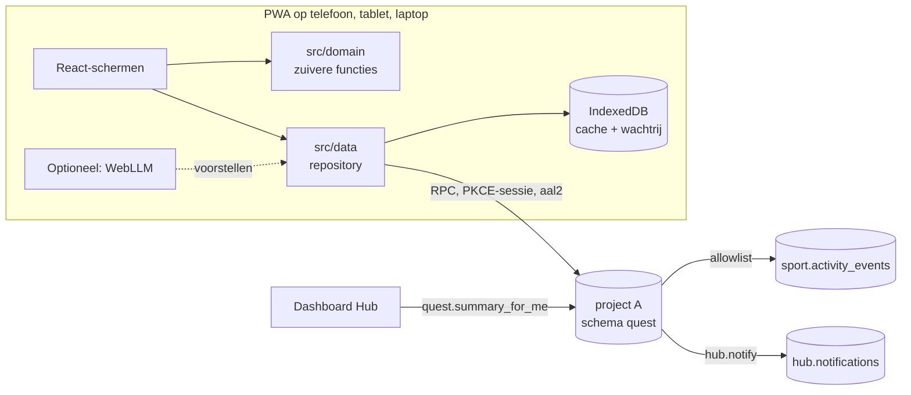

# Architectuur SIDEQUEST

Status: **voorgesteld**. Volledige onderbouwing: [SIDEQUEST_DESIGN.md](../../../docs/sidequest/SIDEQUEST_DESIGN.md) § 6–8. Ecosysteemarchitectuur: [ARCHITECTURE.md](../../../ARCHITECTURE.md).

## Overzicht

## Lagen

| Laag | Map | Verantwoordelijkheid |
|---|---|---|
| Domein | `src/domain/` | `periods`, `recurrence`, `streaks`, `xp`, `levels`, `badges`, `rewards`, `goal-progress`, `challenge-scoring`, `generators`, `holidays-nl`, `ics`. Zonder React of netwerk; ≥ 80% testdekking |
| Data | `src/data/` | Repository-interface met twee implementaties: lokaal (IndexedDB, fase SQ-1) en Supabase met mutatiewachtrij (fase SQ-2) |
| Features | `src/features/` | `today`, `goals`, `quests`, `challenges`, `achievements`, `stats`, `suggestions`, `settings` |
| Componenten | `src/components/` | Voortgangsring, XP-balk, badgekaart, streak met schild; basis uit `packages/ui` |
| App | `src/app/` | Routing, layout, PWA-registratie, foutgrenzen |

## Stack

TypeScript strict, React, Vite, Tailwind via `packages/ui`, React Router, `@supabase/supabase-js` (PKCE), IndexedDB-wrapper uit `packages/`, Vite PWA-plugin, zod, Vitest, Testing Library, Playwright. Geen CDN-scripts.

## Kernprincipes

1. **Doel → quest → voorkomen → XP.** XP en munten staan in onveranderlijke logboeken; saldo is een som.
2. **Missen straft niet.** Streaks zijn periodegebonden en worden berekend uit voorkomens, rustdagen, pauzes en schilden.
3. **Server is bron van waarheid** voor XP, munten, badges en voorkomens. Offline toont de app voorlopige waarden.
4. **Idempotent en conflictvrij:** `client_mutation_id`, unieke (`quest_id`, `period_key`), `version` met `p_expected_version`.
5. **Voorkomens zonder server-planner:** `quest.materialize_occurrences()` bij openen (pg_cron op Free niet geverifieerd).
6. **Voorstellen, geen automatische wijzigingen:** regels en AI schrijven alleen naar `quest.suggestions`.

## Koppelingen

| ID | Richting | Mechanisme | Voorwaarde |
|---|---|---|---|
| I-3 | SIDEQUEST → Hub | `hub.notify()` voor eigen meldingen | Eigen gebruiker |
| I-7 | Hub → SIDEQUEST | `quest.summary_for_me()` (alleen tellers) | Allowlist ADR 0013 |
| I-5 | Sportapp → SIDEQUEST | `quest.ingest_sport_events()` | Toestemming in Hub; Sportapp F4 |
| I-10 | Samen Thuis → SIDEQUEST | `quest.report_external_progress()` (percentage) | **Apart besluit** (S-7; botst met ISO-17) |
| — | Kalender | `.ics`-export en -import in de browser | Geen server (S-8) |

Elke koppeling is optioneel: zonder bron werkt SIDEQUEST gewoon door.

## Fasen

SQ-1 lokaal zonder database → SQ-2 database en sync → SQ-3 uitdagingen → SQ-4 koppelingen → SQ-5 lokale AI. Details en PR-lijst: ontwerp § 12.
