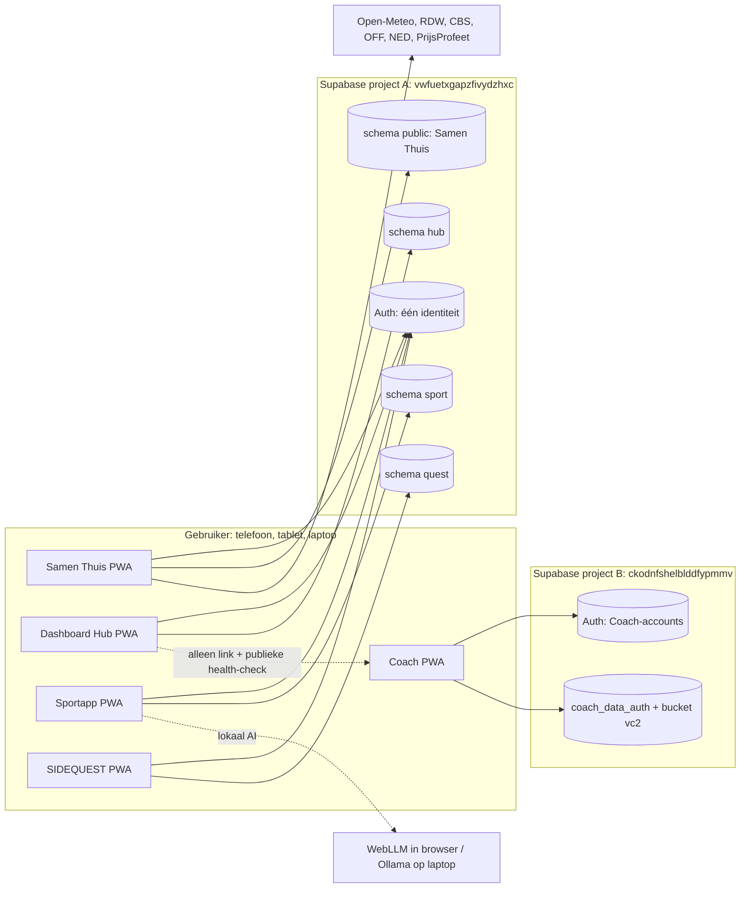

# Architectuur

Status: **goedgekeurd 2026-11-07** met voorwaarden (zie [DECISIONS.md](DECISIONS.md) en [docs/adr/](docs/adr/)).
Basis: [REPO_ANALYSIS.md](REPO_ANALYSIS.md).

## 1. Doelen en harde randvoorwaarden

1. Samen Thuis en Coach blijven bestaan en blijven zelfstandig werken. Geen vervangende apps.
2. Elke app werkt zelfstandig, ook als een andere app, een API of Supabase onbereikbaar is.
3. Gratis is een harde eis: geen verplichte abonnementen, credits of betaalde API's.
4. Elke tabel met persoonlijke of gedeelde gegevens heeft RLS.
5. Geen directe toegang tussen databases van verschillende apps; integratie alleen via expliciete contracten.
6. Beleggen hoort uitsluitend bij Samen Thuis. Warehouse OS bestaat niet en wordt niet gepland.

## 2. Systeemcontext



## 3. Kernkeuzes

### 3.1 Supabase-projecten: twee, niet vijf

Supabase Free staat **2 actieve projecten** toe ([pricing](https://supabase.com/pricing)). Beide zijn in gebruik.
Een derde gratis project is dus niet mogelijk zonder een bestaand project te pauzeren.

**Besluit (B-1, ADR 0001):**

| Project | Bevat | Waarom |
|---|---|---|
| **A** `vwfuetxgapzfivydzhxc` | Samen Thuis (`public`, ongewijzigd) + Hub (`hub`) + Sportapp (`sport`) + SIDEQUEST (`quest`) | Dezelfde gebruikers (jij, Daphne). Eén account voor alle persoonlijke apps. Sportdata en quests zijn persoonlijk, net als huishouddata. |
| **B** `ckodnfshelblddfypmmv` | Alleen Coach | Coach verwerkt gegevens van derden (spelers). Die horen gescheiden van privé- en gezondheidsgegevens. |

Isolatie binnen project A gebeurt met **één Postgres-schema per app**. Een app schrijft nooit in het schema van een andere app.
Voorwaarde bij het akkoord: de isolatie moet **aantoonbaar** zijn. Daarvoor dient het isolatiebewijs ISO-1 t/m ISO-12 in [ADR 0001](docs/adr/0001-supabase-project-a-schema-isolatie.md); zonder groen rapport wordt geen migratie op project A uitgevoerd.
Het schema `public` blijft exclusief eigendom van Samen Thuis; nieuwe apps maken daar niets aan.

### 3.2 Bestaande apps: niet migreren naar React

Samen Thuis en Coach blijven vanilla JS zonder buildstap. Een migratie naar React/TypeScript zou beide apps breken en levert nu geen gebruikerswaarde op.
React + TypeScript + Tailwind geldt **alleen voor nieuwe apps**. Gedeelde afspraken (designtokens, datumformaten, foutmeldingen, testpatronen) gelden wel voor alle apps.

### 3.3 Nieuwe apps: één monorepo, losse deploys

```
personal-ecosystem/              (nieuwe repo; deze documentatie staat in de root)
├─ apps/
│  ├─ hub/                       Dashboard Hub
│  ├─ sport/                     Sportapp
│  └─ sidequest/                 SIDEQUEST
├─ packages/
│  ├─ ui/                        Tailwind-preset, designtokens, basiscomponenten
│  ├─ supabase/                  client-factory, gegenereerde types per schema
│  ├─ auth/                      sessie, login, route-guards
│  ├─ core/                      zuivere hulpfuncties (datum, geld in centen, validatie)
│  └─ testing/                   RLS-testharnas (lokale PostgreSQL), fixtures
├─ supabase/
│  ├─ migrations/                alleen hub_*, sport_*, quest_* migraties
│  ├─ rollbacks/
│  └─ tests/                     RLS- en RPC-tests per schema
├─ docs/adr/                     Architecture Decision Records
└─ *.md                          deze documentatieset
```

- Elke app wordt apart gebouwd en apart gedeployed. Een fout in de ene app blokkeert de andere niet.
- Gedeelde code staat in `packages/` en wordt via npm-workspaces gekoppeld (niets publiceren).
- Samen Thuis en Coach blijven in hun eigen repositories.

### 3.4 Hosting en origins

Apps die op dezelfde origin draaien (bijv. `gebruiker.github.io/app1` en `/app2`) delen `localStorage`, cookies-scope en service-worker-scope. Een kwetsbaarheid in de ene app raakt dan de tokens van de andere.

**Besluit (B-5, ADR 0005):** elke nieuwe app krijgt een **eigen origin** via een apart Cloudflare Pages-project:

| Optie | Origin per app | Kosten | Opmerking |
|---|---|---|---|
| Cloudflare Pages (aanbevolen) | `hub-xxx.pages.dev`, `sport-xxx.pages.dev`, … | Gratis (500 builds/maand) | Eén account, meerdere projecten uit één monorepo |
| GitHub Pages | Eén origin per gebruiker (`kesga44-jpg.github.io`) | Gratis (publieke repo) | Gedeelde origin, tenzij eigen (sub)domein |
| Eigen domein met subdomeinen | `hub.domein.nl`, … | Domeinregistratie is niet gratis | Pas later, optioneel |

Samen Thuis en Coach blijven waar ze staan.

### 3.5 Accounts: gedeelde laag alleen waar het iets oplevert

Zie [AUTHENTICATION.md](AUTHENTICATION.md) voor de afweging. Kort:

- **Wel** gedeeld: Hub, Sportapp, SIDEQUEST en Samen Thuis gebruiken dezelfde Supabase Auth in project A. Voordelen: één wachtwoord, één profiel, server-side gecontroleerde koppelingen (bijv. training telt mee voor een quest), meldingen van alle persoonlijke apps in de Hub.
- **Niet** gedeeld: Coach. Coach houdt eigen accounts in project B. Een gedeelde laag met Coach zou cross-project credentials vereisen en clubgegevens met privégegevens mengen.
- Single sign-on tussen origins bestaat niet automatisch: je logt per app één keer per apparaat in, met hetzelfde account.

### 3.6 Integratie: contracten in plaats van gedeelde tabellen

| Patroon | Gebruik |
|---|---|
| **Deep link** | Hub → elke app; Samen Thuis → Sportapp |
| **Event-tabel + consent** | Sportapp publiceert minimale events (`sport.activity_events`); SIDEQUEST leest die alleen via een security-definer-functie die toestemming controleert |
| **Notificatie-RPC** | Elke app in project A kan via `hub.notify()` een melding voor de **eigen** gebruiker aanmaken |
| **Bestandsexport/-import door gebruiker** | Samen Thuis-sportdata naar Sportapp; nooit database-naar-database |
| **Publieke health-check** | Hub toont status van projecten A en B via `GET /auth/v1/health` |

Details: [INTEGRATIONS.md](INTEGRATIONS.md).

### 3.7 Offline en sync

Alle apps zijn offline-first:

- Bron van waarheid voor **persoonlijke** data in nieuwe apps: de database (RLS per gebruiker). Lokaal: IndexedDB-cache + wachtrij met mutaties.
- Conflicten: optimistische versiecontrole (`version bigint`) zoals `put_household_state`. Bij conflict: gebruiker kiest, nooit stil overschrijven.
- Idempotentie: elke mutatie heeft een client-gegenereerde `client_mutation_id` (uuid); dubbel versturen geeft hetzelfde resultaat.

### 3.8 AI

Gratis en open-source, lokaal waar mogelijk. Volgorde:

1. **Regelgebaseerd** (bestaat al in Samen Thuis en Coach). Altijd beschikbaar.
2. **WebLLM** in de browser (Apache-2.0, vereist WebGPU). Data verlaat het apparaat niet.
3. **Ollama** op eigen laptop (MIT), alleen bereikbaar binnen het eigen netwerk.

Geen betaalde AI-API's. Gezondheidsgegevens gaan nooit naar een externe AI-dienst. AI-uitvoer wordt tegen een vast schema gevalideerd en pas opgeslagen na bevestiging door de gebruiker (bestaand principe uit `SPORT-TRAINING.md`).

## 4. Technologiestack nieuwe apps

| Laag | Keuze | Reden |
|---|---|---|
| Taal | TypeScript (strict) | Typeveiligheid tussen apps en database |
| UI | React | Gevraagd; groot ecosysteem; AI-assistenten kennen het goed |
| Build | Vite | Snel, statische output, gratis te hosten |
| Styling | Tailwind CSS + gedeelde preset in `packages/ui` | Consistent, mobiel-eerst |
| Routing | React Router | Standaard, werkt statisch |
| Data | `@supabase/supabase-js` + gegenereerde types | Officiële client |
| Lokale cache | IndexedDB (via kleine wrapper) | Offline-first, groter dan localStorage |
| PWA | Vite PWA-plugin (Workbox) | Manifest + service worker |
| Tests | Vitest, Testing Library, Playwright, SQL-tests op lokale PostgreSQL | Zie [TESTING.md](TESTING.md) |
| CI | GitHub Actions | Gratis voor publieke repo's |

Versies worden bij de start van fase 2 vastgezet in `package-lock.json`; geen `latest`-ranges.

## 5. Kwaliteitseisen

| Eis | Invulling |
|---|---|
| Mobiel, tablet, desktop | Mobile-first; breakpoints `sm`/`md`/`lg`; test in Playwright op 375, 768 en 1280 px |
| Toegankelijkheid | WCAG 2.2 AA als doel; axe-check in e2e-tests |
| Beveiliging | [SECURITY.md](SECURITY.md); CSP, geen inline scripts, geen externe scripts zonder SRI |
| Prestaties | Initiële JS per app < 200 kB gzip als richtlijn |
| Taal | UI Nederlands; code en identifiers Engels; documentatie Nederlands |
| Onderhoud | Kleine PR's, één onderwerp per PR, tests verplicht |

## 6. Wat expliciet buiten scope valt

- Warehouse OS.
- Beleggen buiten Samen Thuis.
- Migratie van Samen Thuis of Coach naar React.
- Samenvoegen van de Supabase-projecten A en B.
- Betaalde diensten, ook als "tijdelijke" oplossing.
