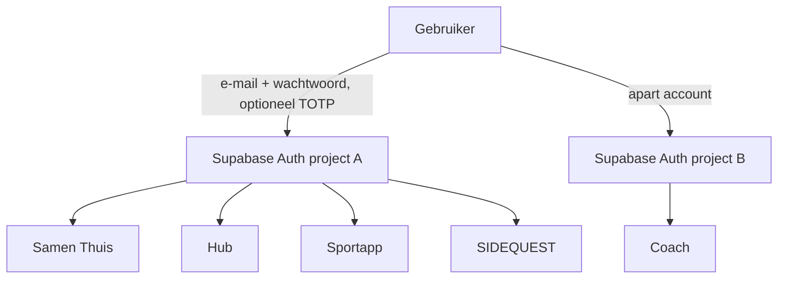

# Authenticatie en autorisatie

## 1. Huidige situatie

| App | Project | Methode | Sessie-opslag | Opmerking |
|---|---|---|---|---|
| Samen Thuis | A | Supabase Auth e-mail/wachtwoord via eigen REST-wrapper | `localStorage` | Zonder login: lokaal + legacy anon-sync met huishoudcode |
| Coach | B | Supabase Auth e-mail/wachtwoord via eigen REST-wrapper | `localStorage` (`footballCoachAuthV1`) | Kennisbank-bucket nog niet via Auth |

Twee projecten = twee aparte gebruikersbestanden. Een account in Samen Thuis bestaat niet in Coach.

## 2. Heeft een gedeelde accountlaag voordelen?

| Criterium | Gedeeld (één Auth in project A) | Per app gescheiden |
|---|---|---|
| Aantal wachtwoorden | 1 | 1 per app |
| Server-side koppelingen (training → quest) | Mogelijk met RLS en consent in één database | Alleen via cross-project credentials of handmatige export |
| Meldingen in Hub van andere apps | Ja, via `hub.notify()` | Alleen met extra infrastructuur |
| Account verwijderen | Eén actie, cascade over alle schema's | Per app |
| Blast radius bij lek | Groter: één account geeft toegang tot alle persoonlijke apps | Kleiner |
| Projectlimiet Free (2 projecten) | Past | Past niet (5 apps) |
| Single sign-on in de browser | Nee: per origin opnieuw inloggen (wel met hetzelfde account) | Nee |

**Conclusie:** een gedeelde laag heeft echte voordelen voor Samen Thuis, Hub, Sportapp en SIDEQUEST, vooral door koppelingen, meldingen, verwijderen en de projectlimiet. Voor Coach niet: andere gebruikersgroep (club), gegevens van derden, en het zou cross-project toegang vereisen.
Het grotere blast-radius-risico wordt beperkt met sterke wachtwoorden, optioneel MFA (TOTP, onderdeel van Supabase Auth) en strikte RLS per schema.

## 3. Doelarchitectuur

- Nieuwe apps gebruiken `@supabase/supabase-js` met PKCE-flow.
- Samen Thuis en Coach houden hun eigen REST-wrapper (niet aanpassen).
- Nieuwe apps tonen **geen** registratiescherm: accounts ontstaan via Samen Thuis of via een uitnodiging in de Hub.
  Let op: "Allow new users to sign up" is een instelling voor het hele project A. Samen Thuis gebruikt registratie, dus uitzetten raakt Samen Thuis en is een apart besluit.
  Ook met open registratie ziet een vreemde niets: alle RLS vereist eigenaarschap, lidmaatschap of een uitnodiging.
- E-mailbevestiging blijft aan. De ingebouwde Supabase-mailer verstuurt maximaal **2 e-mails per uur per project**. Voor een paar gebruikers volstaat dat; meer vereist eigen SMTP (gratis opties eerst verifiëren, zie [API_CATALOG.md](API_CATALOG.md)).

## 4. Sessies en tokens

| Regel | Reden |
|---|---|
| Elke nieuwe app op een eigen origin | Tokens in opslag zijn per origin geïsoleerd |
| Geen externe scripts zonder SRI; strikte CSP | Voorkomt dat derden tokens lezen |
| Access token kort (Supabase-standaard 1 uur), refresh-rotatie aan | Beperkt schade bij diefstal |
| Uitloggen = `signOut({ scope: 'local' })`; Hub biedt "overal uitloggen" (`scope: 'global'`) | Controle voor gebruiker |
| Nooit `service_role`/secret key in frontend of repo | Omzeilt RLS |

## 5. Rollen

### Ecosysteemniveau (`hub.user_app_roles`)

| Rol | Rechten |
|---|---|
| `user` | Eigen data in alle persoonlijke apps |
| `admin` | Hub-beheer: gebruikers uitnodigen, app-register, technische status. **Geen** toegang tot andermans persoonlijke data |

### Per app

| App | Rollen | Bron |
|---|---|---|
| Samen Thuis | `owner`, `admin`, `member` per huishouden | Bestaand (`household_members`) |
| Coach | Eén eigenaar per account | Bestaand |
| Sportapp | Persoonlijk: eigenaar. Groep: `owner`, `admin`, `member` | `sport.group_members` |
| SIDEQUEST | Persoonlijk: eigenaar. Uitdaging: `creator`, `participant` | `quest.challenges`, `quest.challenge_participants` |

Autorisatie gebeurt **altijd in de database** (RLS en RPC-controles). De UI verbergt knoppen alleen voor gebruiksgemak.

## 6. Uitnodigingen

1. Admin of groepseigenaar maakt een uitnodiging (RPC) met een eenmalige code, vervaltijd 7 dagen. Alleen de hash wordt opgeslagen.
2. De ontvanger heeft al een account in project A, of maakt er een via de uitnodigingslink.
3. Accepteren gebeurt via RPC; die controleert code, vervaltijd en maximaal aantal leden.

## 7. Toegangsmatrix (samengevat)

| Actor ↓ / Data → | Eigen sportdata | Sportdata ander | Klassement groep | Eigen quests | Quests ander | Huishouddata | Coach-data |
|---|---|---|---|---|---|---|---|
| Gebruiker zelf | Lezen/schrijven | — | Lezen (gedeelde metrics) | Lezen/schrijven | — | Als lid | Alleen eigen Coach-account |
| Groepslid | — | Nee | Lezen | — | Nee | — | — |
| Huisgenoot | — | Nee | — | — | Nee | Lezen/schrijven | — |
| Ecosysteem-admin | — | Nee | Nee | — | Nee | Nee | Nee |
| `anon` | Nee | Nee | Nee | Nee | Nee | Nee (na fase-1-fix R1) | Nee |
| SIDEQUEST (app) namens gebruiker | `activity_events` met consent | Nee | — | — | — | — | — |
