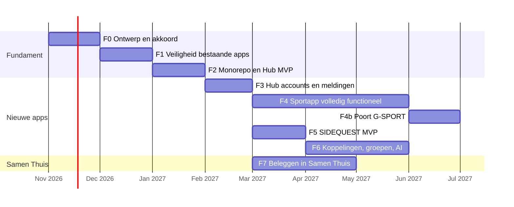

# Ontwikkelroadmap

Elke fase start pas na akkoord op de vorige. Elke fase heeft meetbare eindcriteria.
Volgorde: eerst de bestaande apps veilig, dan het fundament, dan pas nieuwe functionaliteit.

De tijdsindicatie gaat uit van werken in vrije tijd met AI-assistenten; het is geen toezegging.

## F0 — Ontwerp en akkoord (nu)

- Deze documentatieset.
- Besluiten B-1 t/m B-12 in [DECISIONS.md](DECISIONS.md).
- Ontbrekende informatie aanvullen (origins, anon-status, databasegebruik, Coach-gebruikers).

**Klaar als:** alle besluiten genomen en vastgelegd als ADR.

## F1 — Veiligheid, back-ups en basis bestaande apps

Volgens ADR 0011: elke regel is **één afzonderlijke PR** (of één afzonderlijke databasehandeling), elk pas na jouw goedkeuring van het voorstel. Geen nieuwe functies. Back-ups komen eerst, zodat elke latere wijziging herstelbaar is.

| PR | Wijziging | Repo | Risico | Afhankelijk van |
|---|---|---|---|---|
| PR-1 | CI-workflow die alleen de bestaande tests draait | Samen Thuis | Laag | — |
| PR-2 | CI-workflow die alleen de bestaande tests draait | Coach | Laag | — |
| PR-3 | Back-up database + opslag, versleuteld, met maandelijkse hersteltest (ADR 0010) | Nieuwe privé-repo `ecosystem-backups` | Laag (alleen lezen uit projecten) | B-14, secrets door jou ingesteld |
| — | Eerste handmatige hersteloefening | Lokaal | Laag | PR-3 |
| PR-4 | pdf.js 3.11.174 → 4.10.38 | Coach | Laag–middel (API v3→v4) | PR-2 |
| PR-5 | SheetJS upgraden + SRI, exact pinnen | Coach | Laag–middel | PR-2 |
| PR-6 | SheetJS upgraden + SRI, exact pinnen (incl. tesseract.js) | Samen Thuis | Laag–middel | PR-1 |
| PR-7 | BrainyQuote-script verwijderen; lokale citaten | Samen Thuis | Laag | PR-1 |
| PR-8 | Edge Functions: JWT aan, CORS-allowlist, invoerlimieten | Samen Thuis | Middel (app moet token meesturen) | PR-1 |
| PR-9 | Coach-backend verifiëren (tabel, RLS) + SQL-test naar Samen Thuis-patroon | Coach | Laag | PR-2 |
| PR-10 | Coach: bucket `vc2` naar Auth-RLS | Coach | Middel | PR-9, PR-3 |
| PR-11 | Coach: AI-endpoint beperken / spelersnamen niet meesturen (R9) | Coach | Laag | PR-2 |
| DB-1 | Fase-3-script anon-intrekking uitvoeren op project A (R1) | Samen Thuis-database | Middel | Beide gebruikers op accountsync; verse back-up met geslaagde hersteltest |
| PR-12 | Opruimen verouderde bestanden (`js/`, oude CSS, leeg `index.ts`) en achterhaalde documentatie | Samen Thuis | Laag | PR-1 |

**Klaar als:** CI groen in beide repo's; eerste automatische én handmatige hersteltest geslaagd (database + bestanden); R1–R9 opgelost of bewust geaccepteerd.

## F2 — Monorepo en Hub MVP (zonder database)

- Repo `personal-ecosystem` met deze documentatie, npm-workspaces, `packages/ui`, `packages/core`, CI, Dependabot.
- Hub: app-tegels met deep links uit `registry.json`, status van projecten A/B (health), versie-info, PWA, responsive.
- Cloudflare Pages-project `hub`.

**Klaar als:** Hub installeerbaar op telefoon/tablet/laptop, Lighthouse PWA- en toegankelijkheidscontroles zonder fouten, CI groen.

## F3 — Hub: accounts, toegang en meldingen

- CI-job `isolation` met het volledige isolatiebewijs ISO-1 t/m ISO-12 (ADR 0001), draaiend op Samen Thuis-migraties + ecosysteem-migraties.
- Migratie schema `hub` (apps, roles, consents, notifications, audit, heartbeats) + RLS-tests. Uitvoering op project A alleen met groen isolatierapport en verse back-up.
- Inloggen met bestaand Samen Thuis-account (project A).
- Accountbeheer: profiel tonen, wachtwoord wijzigen, overal uitloggen, data-export, account verwijderen (met waarschuwing dat Samen Thuis-data meegaat).
- Meldingencentrum (in-app).

**Klaar als:** RLS-tests dekken alle `hub`-tabellen; jij en Daphne kunnen inloggen; meldingen werken in-app.

## F4 — Sportapp MVP

- Schema `sport` (profiel, oefeningen, schema's, sessies, sets, metingen, herstel) + RLS-tests.
- Trainingsregistratie offline-first; handmatige GPX/FIT/TCX-import (samenvatting, ADR 0009).
- Volledige pariteit met Samen Thuis Sport & Training, inclusief bibliotheek met privébestanden (zie pariteitstabel ADR 0002).
- Herhaalbare, idempotente import uit Samen Thuis-back-up (I-6) en bestanden (I-6b) met automatisch reconciliatierapport.
- Regelgebaseerde coach (logica uit `sportcoach-core.js`, herschreven in TypeScript met dezelfde scenario's als referentietests).
- Samen Thuis Sport & Training blijft **volledig in gebruik**; geen freeze in deze fase.

**Klaar als:** een week training registreren zonder netwerk en later synchroniseren werkt; pariteitstabel ADR 0002 volledig groen.

## F4b — Poort G-SPORT (overgang)

- Kees en Daphne importeren ieder het eigen profiel; reconciliatierapport toont 0 verschillen of alleen geaccepteerde afwijkingen; steekproef gedaan; akkoord vastgelegd.
- Daarna, als **apart besluit**: voorstel feature freeze + link "Open in Sportapp" in Samen Thuis (losse PR, ADR 0011). Samen Thuis-data wordt nooit automatisch verwijderd.

**Klaar als:** G-SPORT gehaald en freeze-besluit genomen (akkoord of uitgesteld).

## F5 — SIDEQUEST MVP

- Schema `quest` (doelen, gewoontes, checks, quests, stappen, XP-logboek, badges) + RLS-tests.
- Gewoontes afvinken met streaks; quests met handmatige stappen; XP en levels.
- Hub-tegel met tellers (I-7).

**Klaar als:** dubbel afvinken levert nooit dubbel XP (getest offline en op twee apparaten).

## F6 — Koppelingen, groepen, voeding, AI, push

- I-5 Sport → SIDEQUEST met toestemmingsscherm in Hub.
- Sportgroepen en klassementen met opt-in per metriek.
- Gedeelde uitdagingen in SIDEQUEST.
- Voeding via Open Food Facts (barcodescan met camera).
- Lokale AI-coach met WebLLM (alleen als WebGPU beschikbaar; anders regelgebaseerd).
- Web Push via Hub.

**Klaar als:** intrekken van toestemming stopt koppeling direct; groepsleden kunnen aantoonbaar (test) geen privédata zien.

## F7 — Beleggen en vermogensbeheer (in Samen Thuis)

- Ontwerp in de Samen Thuis-repo: posities, transacties, waardering, vermogensoverzicht, koppeling met bestaand budgetveld `investing`.
- Koersdata alleen uit een gratis, verifieerbare bron of handmatige invoer. Nog geen bron gekozen.
- Geen advies- of handelsfunctie.

**Klaar als:** eigen ADR in Samen Thuis; module met tests; geen afhankelijkheid van betaalde data.

## Doorlopend

- Maandelijks: limieten controleren ([API_LIMITS.md](API_LIMITS.md)), Dependabot-PR's verwerken.
- Per kwartaal: hersteltest back-up, review van API-voorwaarden.
