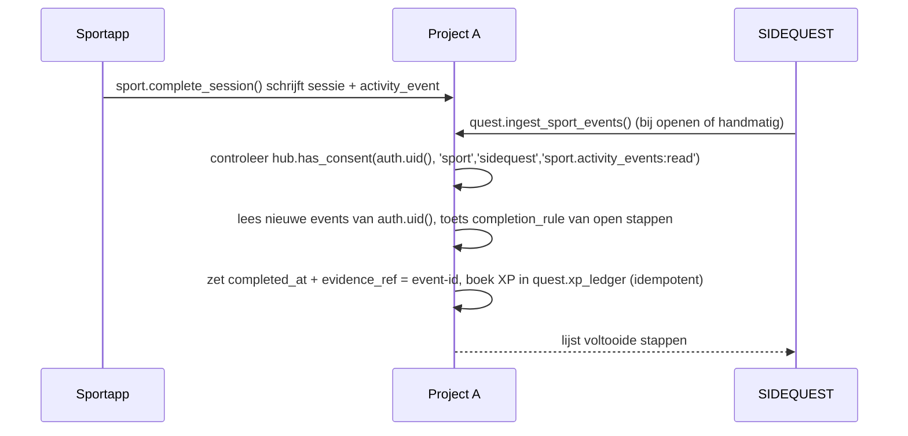

# Integraties tussen apps

Regel: apps praten nooit direct met elkaars tabellen. Elke koppeling is een **contract** met een eigenaar, een versie en tests.
Elke koppeling is optioneel: als de bron ontbreekt of de toestemming is ingetrokken, werkt de ontvangende app gewoon door.

## Overzicht

| ID | Van → naar | Mechanisme | Toestemming | Fase |
|---|---|---|---|---|
| I-1 | Hub → alle apps | Deep link (`registry.json`) | Geen | 2 |
| I-2 | Hub → project A en B | `GET /auth/v1/health` (publiek) | Geen | 2 |
| I-3 | Hub, Sportapp, SIDEQUEST → Hub-meldingen | RPC `hub.notify()` (alleen eigen gebruiker) | Impliciet (eigen data) | 3 |
| I-4 | Hub → apparaat | Web Push via Edge Function `hub-push` (VAPID) | Expliciete opt-in per apparaat | 6 |
| I-5 | Sportapp → SIDEQUEST | `sport.activity_events` gelezen via `quest.ingest_sport_events()` | `hub.integration_consents` scope `sport.activity_events:read` | 6 |
| I-6 | Samen Thuis → Sportapp | Gebruiker exporteert JSON-back-up; Sportapp-importer leest alleen `sportCoach`; herhaalbaar | Gebruiker kiest bestand | 4 |
| I-6b | Samen Thuis-bucket → Sportapp | Alleen-lezen download met eigen sessie, upload naar `sport-media` | Gebruiker kiest items | 4 |
| I-7 | SIDEQUEST → Hub | `quest.summary_for_me()` (tellers: open quests, streak) | Impliciet (eigen data) | 5 |
| I-8 | Sportapp → Hub | `sport.summary_for_me()` (trainingen deze week) | Impliciet | 4 |
| I-9 | Samen Thuis → Hub-meldingen | `hub.notify()` vanuit Samen Thuis | Opt-in in Samen Thuis | Later, wijziging in Samen Thuis-repo |
| — | Coach ↔ overige | **Geen** datakoppeling. Alleen I-1 en I-2 | — | — |

## I-5 in detail: training telt mee voor een quest

- SIDEQUEST ziet alleen `event_type`, `occurred_at`, `type`, `duration_s`, `distance_m`. Geen hartslag, gewicht, notities of locatie.
- Idempotent: een event kan maar één keer XP opleveren (unieke sleutel op `evidence_ref`).
- Toestemming intrekken stopt nieuwe verwerking; eerder verdiende XP blijft (logboek is onveranderlijk).

## I-6 in detail: overstap uit Samen Thuis Sport & Training

1. In Samen Thuis: bestaande JSON-back-up maken (bestaande functie, geen wijziging nodig).
2. In Sportapp: "Importeren uit Samen Thuis" → bestand kiezen.
3. Importer leest alleen `data.sportCoach` en alleen het profiel dat de gebruiker kiest (Kees óf Daphne).
4. Voorbeeld tonen; pas opslaan na bevestiging (patroon `import-core.js`).
5. Records krijgen `source = 'import_samen_thuis'` en de oorspronkelijke ID in `external_ref`, zodat opnieuw importeren geen dubbelen maakt.
6. Samen Thuis blijft ongewijzigd en blijft volledig bruikbaar (geen freeze tot poort G-SPORT, [ADR 0002](docs/adr/0002-sport-overgang-zonder-vroege-freeze.md)).
7. De import is herhaalbaar: opnieuw importeren neemt alleen nieuwe of gewijzigde records over (op `external_ref` + checksum).
8. Na elke import maakt Sportapp een reconciliatierapport (aantallen, checksums per record, SHA-256 per bestand).

### I-6b: bibliotheekbestanden

- De back-up bevat alleen verwijzingen naar bestanden in bucket `sport-training`.
- Sportapp downloadt de gekozen bestanden **alleen-lezen** met de sessie van de gebruiker zelf; de bestaande Samen Thuis-policy staat dat al toe voor huishoudleden. Er wordt niets in `sport-training` geschreven of verwijderd.
- Upload naar `sport-media/<user_id>/…`, SHA-256 vergelijken, opnemen in het reconciliatierapport.
- De Samen Thuis-bibliotheek is gedeeld binnen het huishouden; in Sportapp kiest elke gebruiker welke items hij of zij overneemt (persoonlijke kopie). Dit is de enige bewuste duplicatie, nodig omdat Samen Thuis-data niet wordt verwijderd.

## Contractregels

1. Elk contract staat in deze tabel met ID, eigenaar en fase.
2. De bron-app is eigenaar van het contract en mag het alleen backward-compatible wijzigen; breaking changes krijgen een nieuwe versie (`activity_events_v2`) en een overgangsperiode.
3. Contracttests in de monorepo: een test in de bron-app én in de ontvanger.
4. Geen koppeling zonder uitvaltest: de ontvanger moet werken als de bron leeg of onbereikbaar is.

## Externe integraties

Zie [API_CATALOG.md](API_CATALOG.md). Externe API's worden aangeroepen:

- rechtstreeks vanuit de browser als de API publiek, gratis en zonder key is (Open-Meteo, Open Food Facts);
- via een Edge Function met JWT-controle als er een key nodig is (NED, PrijsProfeet);
- nooit vanuit een Edge Function zonder JWT-controle.
