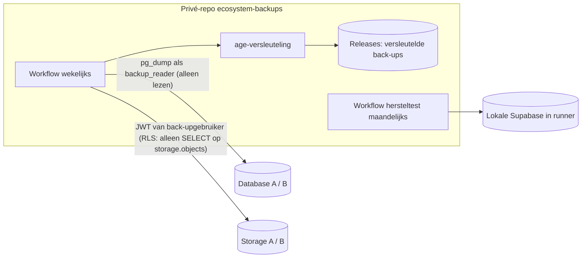

# ADR 0014 — Back-uptoegang zonder service key: ontwerp, sleutelbeheer, retentie en herstel

- **Status:** voorgesteld (2026-11-07), ter beoordeling. **PR-3 wordt pas gebouwd na akkoord.**
- **Besluit-ID:** B-14 (uitwerking van ADR 0010)
- **Voorwaarden eigenaar:** geen service key zonder akkoord; eerst onderzoeken of een aparte S3-sleutel kan, anders een alternatief ontwerp; nooit een sleutel met volledige toegang in applicatiecode, de Hub of een gedeelde omgeving; encryptie, sleutelbeheer, retentie en hersteltests uitwerken.

## 1. Onderzoek: is een aparte S3-sleutel een goede optie?

| Vraag | Bevinding | Bron |
|---|---|---|
| Bestaat een aparte S3-sleutel? | Ja: Access Key ID + Secret Access Key, aan te maken in de Storage-instellingen | [S3 auth](https://supabase.com/docs/guides/storage/s3/authentication) |
| Beschikbaar op Free? | **Niet geverifieerd.** De prijspagina noemt het S3-protocol niet; de documentatie noemt geen planbeperking. Alleen te controleren in het dashboard (Storage → Settings → S3) | [pricing](https://supabase.com/pricing.md) |
| Rechten | Volledige toegang tot **alle** S3-operaties op **alle** buckets (dus ook schrijven en verwijderen), en omzeilt RLS | [S3 auth](https://supabase.com/docs/guides/storage/s3/authentication) |
| Beperken tot één bucket of alleen-lezen? | Niet gedocumenteerd | idem |
| Alternatief binnen S3 | S3 met een **sessietoken** van een gewone gebruiker: dan geldt RLS | idem |

**Conclusie:** een S3-sleutel is minder breed dan de service key (alleen Storage, geen database of Auth-beheer), maar geeft wel schrijf- en verwijderrechten op alle bestanden. Een back-up heeft alleen leesrechten nodig. Daarom raad ik ook de S3-sleutel **af** en stel ik hieronder een alternatief voor met alleen leesrechten.

## 2. Voorgesteld ontwerp: aparte back-upidentiteiten met alleen leesrechten

| Onderdeel | Identiteit | Rechten | Waarom |
|---|---|---|---|
| Database | Postgres-rol `backup_reader` (LOGIN, via session pooler) | Lid van `pg_read_all_data`, plus `BYPASSRLS` zodat `pg_dump` alle rijen ziet. **Geen** schrijfrechten, geen `CREATE`, geen beheer | Volledige en consistente dump zonder beheerrechten |
| Storage | Aparte Supabase Auth-gebruiker `backup-reader` (eigen e-mailadres, geen huishouden, geen app-binding) | Eén nieuwe RLS-policy per project: `SELECT` op `storage.objects` voor de genoemde buckets, alleen voor deze gebruiker. Downloaden via de Storage API of S3 met sessietoken (RLS geldt) | Alleen lezen; geen schrijven of verwijderen mogelijk |
| Opslag van geheimen | GitHub-secrets in **uitsluitend** de privé-repo `ecosystem-backups` | — | Nooit in applicatiecode, de Hub, de monorepo of een gedeelde omgeving |

Belangrijk: `backup_reader` kan **alles lezen**, inclusief `auth`-tabellen en versleutelde payloads. Dat is inherent aan een volledige back-up. Het verschil met de service key: geen schrijf-, verwijder- of beheerrechten, en los in te trekken.

### Te verifiëren vóór bouw

| # | Vraag | Hoe | Gevolg als nee |
|---|---|---|---|
| V1 | Mag de `postgres`-rol in Supabase een rol met `BYPASSRLS` aanmaken? | Eerst in lokale Supabase (CLI), daarna alleen-lezende controle in productie na jouw akkoord | `pg_dump` mist rijen achter RLS. Dan blijft alleen het `postgres`-wachtwoord over (beheerrechten): apart besluit |
| V2 | Kan een eigen rol inloggen via de session pooler (IPv4)? | Lokaal niet te testen; in productie na akkoord | Alternatief: dump draaien vanaf jouw laptop via IPv6 of de pooler, handmatig |
| V3 | Geeft de Storage-lijst-API per object een `eTag`/`lastModified` voor incrementele back-up? | Lokaal met Supabase CLI | Dan per object een SHA-256 na download; meer egress |
| V4 | Bucketpolicies van Coach (`vc2`) | Dashboard project B (zie ook PR-9) | Storage-back-up van B wacht op PR-10 (`vc2` naar Auth) |

### Wijzigingen in de projecten (pas na apart akkoord)

- Project A en B: rol `backup_reader` + één `SELECT`-policy op `storage.objects` voor de back-upgebruiker. Dit is een **databasewijziging**: aparte goedkeuring, vooraf een handmatige export.
- In project A raakt de nieuwe policy `storage.objects`, waar ook de Samen Thuis-buckets onder vallen. Bestaande policies blijven ongewijzigd; het isolatiebewijs (ISO-6) krijgt deze ene policy als bekende uitzondering.

## 3. Alternatieven

| Optie | Rechten | Volledig? | Oordeel |
|---|---|---|---|
| **A. Aparte identiteiten met alleen leesrechten (voorstel)** | Alleen lezen | Ja (database + alle bestanden) | Aanbevolen, mits V1/V2 slagen |
| B. S3-sleutel | Lezen, schrijven en verwijderen in alle buckets | Alleen bestanden | Afgeraden: meer rechten dan nodig; beschikbaarheid op Free onbekend |
| C. Service key | Alles (database, Auth-beheer, Storage) | Ja | Afgewezen (B-14) |
| D. `postgres`-wachtwoord voor de dump | Beheer van de database | Ja (alleen database) | Alleen als V1 faalt, en alleen na apart akkoord |
| E. Alleen exports door de gebruikers zelf (laptop, eigen sessie) | Eigen rechten | **Nee**: geen andermans privédata, geen Auth, geen volledige bestanden | Blijft als aanvulling, niet als herstelbasis |

## 4. Encryptie

- `age` (X25519) uit de Ubuntu-pakketbron; versleutelen gebeurt vóór de upload, in dezelfde workflowstap als de dump. Onversleutelde data komt nooit buiten de runner.
- Twee ontvangers per bestand:
  1. **Offline eigenaarsleutel**: gemaakt op jouw laptop, privésleutel in je wachtwoordmanager plus een papieren kopie op een veilige plek. Nooit op GitHub.
  2. **CI-hersteltestsleutel**: alleen als GitHub-secret in `ecosystem-backups`, uitsluitend gebruikt door de hersteltestworkflow.
- Waarom een CI-sleutel acceptabel is: wie de secrets van die repo kan lezen, heeft via `backup_reader` toch al leestoegang tot de live data. De extra sleutel vergroot het risico dus nauwelijks en maakt automatische hersteltests mogelijk. Wil je dat niet: zie keuze K-2.
- Integriteit: SHA-256 van elk versleuteld bestand in `MANIFEST.sha256` per release; de hersteltest controleert die hashes eerst.

## 5. Sleutelbeheer

| Sleutel/geheim | Waar | Wie | Rotatie | Intrekken bij incident |
|---|---|---|---|---|
| Offline age-sleutel | Wachtwoordmanager + papier | Eigenaar | Elke 2 jaar | Nieuwe sleutel; oude bewaren tot de laatste back-up ermee is verlopen (≤ 6 maanden), daarna vernietigen |
| CI age-sleutel | Secret `AGE_RESTORE_KEY` | Workflow hersteltest | Jaarlijks | Verwijderen; nieuwe publieke sleutel in de repo |
| `backup_reader`-wachtwoord A/B | Secrets `DB_A_URL`, `DB_B_URL` | Workflow back-up | Elke 6 maanden | `alter role backup_reader nologin` + nieuw wachtwoord |
| Back-upgebruiker Storage A/B | Secrets `STORAGE_A_USER/PASS`, `…_B_…` | Workflow back-up | Elke 6 maanden | Gebruiker blokkeren in Supabase Auth; policy verwijderen |

Regels:

- Alleen de eigenaar heeft toegang tot `ecosystem-backups`; geen samenwerkers en geen apps van derden.
- Workflows: `permissions: contents: write` alleen voor de stap die een release maakt; acties gepind op commit-SHA; alleen `actions/checkout` als externe actie. Supabase CLI downloaden met controle van de checksum.
- Geen secrets in logs (`::add-mask::`); geen `set -x`.
- Rotatiedata in `ecosystem-backups/KEYS.md` (alleen data en vingerafdrukken, nooit sleutels).

## 6. Retentie

| Wat | Bewaartermijn |
|---|---|
| Wekelijkse back-up | 4 weken |
| Maandelijkse back-up (eerste van de maand) | 6 maanden |
| Back-ups van Coach (persoonsgegevens van derden) | Maximaal 6 maanden |
| Hersteltestrapporten (zonder persoonsgegevens) | 2 jaar |

- Opschonen gebeurt automatisch door de workflow (releases verwijderen).
- **Verwijderde accounts:** hun data blijft maximaal 6 maanden in back-ups staan. De workflow houdt een lijst bij van verwijderde `user_id`'s (alleen ID's). Na elk herstel worden die opnieuw verwijderd, vóór de apps weer online gaan.
- Huisgenoot informeren: Daphnes gegevens staan ook in de back-ups.

## 7. Herstelprocedure

1. Release kiezen; `MANIFEST.sha256` controleren.
2. Ontsleutelen met de offline sleutel (bij een echt herstel) of de CI-sleutel (bij een test).
3. Lokale controle: herstellen in de Supabase CLI; aantallen en hashes vergelijken.
4. Productieherstel (alleen na jouw expliciete akkoord): project pauzeren of in onderhoudsmodus zetten → rollen, schema en data terugzetten → bestanden opnieuw uploaden → verwijderde accounts opnieuw verwijderen → rooktest met testaccount → isolatietests → apps weer openen.
5. Vastleggen in `RESTORE_LOG.md`: datum, release, duur (RTO), afwijkingen.

## 8. Hersteltests

| Test | Frequentie | Wat | Norm |
|---|---|---|---|
| Automatisch | Maandelijks + na elke wijziging aan de back-upworkflow | Laatste release → hashes → ontsleutelen (CI-sleutel) → lokale Supabase in runner → rijen per tabel vergelijken met het aantal bij de dump → SHA-256 van elk bestand vergelijken → isolatietests op de herstelde database | 0 verschillen; rapport zonder persoonsgegevens; bij falen een issue |
| Handmatig | Elk kwartaal | Volledig herstel op je laptop met de **offline** sleutel; één app lokaal laten verbinden en inloggen met een testaccount | Gelukt, RTO ≤ 4 uur, vastgelegd |
| Vóór elke migratie | Per migratie | Verse back-up + automatische hersteltest van precies die back-up | Groen vóór uitvoering |

## 9. Keuzes voor jou

| # | Keuze | Aanbeveling |
|---|---|---|
| K-1 | Ontwerp A (aparte identiteiten met alleen leesrechten) in plaats van een S3-sleutel of service key | Ja |
| K-2 | CI-hersteltestsleutel (automatische maandelijkse hersteltest) **of** alleen handmatige hersteltests met de offline sleutel (automatische test controleert dan alleen hashes) | CI-sleutel |
| K-3 | Akkoord om V1–V3 eerst lokaal te onderzoeken met de Supabase CLI (geen productie) | Ja |
| K-4 | Daarna aparte goedkeuring voor de twee databasewijzigingen (rol + Storage-policy) in A en B | Bij de PR-3-aanvraag |
