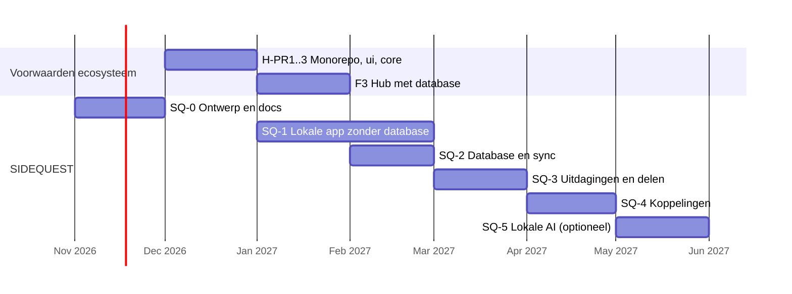

# SIDEQUEST — analyse, functioneel en technisch ontwerp

Status: **voorgesteld (2026-11-07)**, wacht op goedkeuring. Er is niets gebouwd, gemigreerd of aan bestaande apps gewijzigd.
Basis: de goedgekeurde architectuur in deze repo ([ARCHITECTURE.md](../../ARCHITECTURE.md), [APP_REGISTRY.md](../../APP_REGISTRY.md), [DATA_OWNERSHIP.md](../../DATA_OWNERSHIP.md), [DATABASE_DESIGN.md](../../DATABASE_DESIGN.md) § 5, [AUTHENTICATION.md](../../AUTHENTICATION.md), [INTEGRATIONS.md](../../INTEGRATIONS.md), ADR 0001–0012) en het Hub-ontwerp ([HUB_DESIGN.md](../hub/HUB_DESIGN.md)).
Basis: de goedgekeurde architectuur in deze repo ([ARCHITECTURE.md](../../ARCHITECTURE.md), [APP_REGISTRY.md](../../APP_REGISTRY.md), [DATA_OWNERSHIP.md](../../DATA_OWNERSHIP.md), [DATABASE_DESIGN.md](../../DATABASE_DESIGN.md) § 5, [AUTHENTICATION.md](../../AUTHENTICATION.md), [INTEGRATIONS.md](../../INTEGRATIONS.md), ADR 0001–0012), besluitronde 2 in [DECISIONS.md](../../DECISIONS.md) met de voorgestelde [ADR 0013](../adr/0013-app-gebonden-sessies-en-verplichte-totp.md) (app-gebonden sessies, verplichte TOTP) en [ADR 0014](../adr/0014-backuptoegang-zonder-service-key.md), en het Hub-ontwerp ([HUB_DESIGN.md](../hub/HUB_DESIGN.md)).

Dit ontwerp gaat uit van optie C uit ADR 0013. Wordt daar anders besloten (bijv. optie B, aparte accounts per app), dan vervallen of verzwaren de koppelingen in § 7.

Dit document volgt de opdracht "PROJECT: SIDEQUEST" en geeft per eis aan: past binnen de architectuur, vraagt een uitbreiding, of botst. Uitbreidingen en botsingen staan als besluit S-1 t/m S-14 in § 13.

---

## 1. Samenvatting

- SIDEQUEST is de persoonlijke doelen-, quest- en gamificationapp van het ecosysteem: `apps/sidequest` in de monorepo, eigen Cloudflare Pages-origin, schema `quest` in project A, gedeelde Auth (ADR 0005–0007).
- Kernidee: **doel → quests → voltooiingen → XP**. Doelen beschrijven wat je wilt bereiken; quests zijn de concrete opdrachten; elke voltooiing levert XP via een onveranderlijk logboek.
- **Gemiste dagen wissen nooit opgebouwde voortgang.** XP en levels dalen nooit door missen; streaks hebben rustdagen, schilden en pauzes; naast de streak staat altijd een consistentiescore over 30 dagen en de beste streak ooit.
- SIDEQUEST beheert alleen quests en gamification. Sport- en financiële brongegevens blijven in Sportapp en Samen Thuis; SIDEQUEST bewaart alleen een verwijzing (ID) en een afgeleide voortgang.
- AI is regelgebaseerd en altijd beschikbaar; lokale AI (WebLLM) is optioneel. AI doet alleen **voorstellen**; niets wordt opgeslagen zonder bevestiging (ADR 0008).
- Bouw in fasen, zoals bij de Hub: eerst een **lokale versie zonder database** (alle logica + UI, IndexedDB), daarna database, delen en koppelingen — elke databasestap pas na isolatierapport, back-up met hersteltest en akkoord.
- Externe API's zijn nauwelijks nodig. Feestdagen en herhalingen worden lokaal berekend; kalender via `.ics`-bestanden (geen Google-koppeling).

## 2. Toetsing van de opdracht aan de architectuur

| # | Eis | Oordeel | Toelichting |
|---|---|---|---|
| 1 | Meerdere gebruikers, eigen profielen | Past | Gedeelde Auth project A. Accounts ontstaan via Samen Thuis of een Hub-uitnodiging; SIDEQUEST krijgt geen registratiescherm (AUTHENTICATION § 3). SIDEQUEST-profiel (`quest.profiles`) bevat alleen app-instellingen; naam en foto komen uit het bestaande profiel. |
| 1 | Meerdere gebruikers, eigen profielen | Past | Gedeelde Auth project A, met app-gebonden sessies en verplichte TOTP (ADR 0013, voorgesteld): een SIDEQUEST-sessie geeft alleen toegang tot `quest`, en alleen met `aal2`. Accounts ontstaan via Samen Thuis of een Hub-uitnodiging; SIDEQUEST krijgt geen registratiescherm (AUTHENTICATION § 3). SIDEQUEST-profiel (`quest.profiles`) bevat alleen app-instellingen; naam en foto komen uit het bestaande profiel. |
| 1 | Persoonlijke doelen, privé-uitdagingen | Past | RLS `user_id = auth.uid()`; huisgenoten zien niets (ISO-8). |
| 1 | Optioneel gedeelde groepen | **Uitbreiding** | Architectuur kent alleen deelnemers per uitdaging. Voorstel: eerst uitnodigen per uitdaging; vaste groepen (`quest.parties`) later. → S-5 |
| 1 | Rollen en toegangsrechten | Past, met uitbreiding | Uitdaging: `creator`, `participant` (bestaand). Groep: `owner`, `admin`, `member` (na S-5). Ecosysteem-admin heeft **geen** toegang tot questdata. |
| 2 | Doelen dag/week/maand/jaar/lange termijn, categorieën, mijlpalen, deadlines, volledig configureerbaar | **Uitbreiding** | `quest.goals` uit DATABASE_DESIGN is minimaal. Uitbreiding met horizon, meeteenheid, doelwaarde, subdoelen, mijlpalen, eigen categorieën. |
| 3 | Eenmalige, dagelijkse, wekelijkse, terugkerende, meerstaps-, tijdelijke, eigen en automatisch gegenereerde quests, gekoppeld aan doelen | **Uitbreiding** | Eén questmodel met `kind` en herhalingsregel; gewoontes worden terugkerende quests. Wijkt af van `quest.habits` + `quest.habit_checks`. → S-3 |
| 4 | XP, levels, badges, prestaties, streaks, statistieken, voortgangsbalken, beloningen, eigen beloningen | Past, met uitbreiding | XP-logboek bestaat in ontwerp. Eigen beloningen vragen een tweede, uitgeefbare valuta, zodat uitgeven nooit levels verlaagt. → S-4 |
| 4 | Gemiste dagen wissen niet alles | Past | XP-logboek is onveranderlijk; missen boekt nooit negatieve XP. Streakregels in § 4.4. |
| 5 | Individuele, gezamenlijke, groeps-, tijdgebonden uitdagingen, klassementen, persoonlijke verbetering | Past, met uitbreiding | `quest.challenges` + `challenge_participants` bestaan. Toevoegen: soort, meetwijze, scoring, voortgang per deelnemer. |
| 5 | Privé of gedeeld naar keuze | Past | `visibility` (`private`, `invited`, later `party`). |
| 5 | Uitdagingen met huisgenoten | **Let op** | ADR 0003: huishoud-challenges met puntenpot en beloningen horen bij Samen Thuis. Voorstel: gedeelde uitdaging met huisgenoot mag in SIDEQUEST, maar zonder koppeling aan de puntenpot of huishoudbeloningen. → S-6 |
| 6 | Dashboard | Past | § 5. Aanpasbare widgets, indeling per gebruiker. |
| 7 | Dashboard Hub | Past | I-7 `quest.summary_for_me()` en `hub.notify()` (I-3) bestaan in de architectuur. Vereist dat Hub F3 (schema `hub`) is uitgevoerd. |
| 7 | Sportapp | Past | I-5 bestaat (activity events met toestemming). Vereist Sportapp F4. Sportapp-**trainingsdoelen** zelf zitten niet in het contract; zie § 7.2. |
| 7 | Samen Thuis-spaardoel als persoonlijk doel | **Botst gedeeltelijk** | Spaardoelen staan versleuteld in `public.household_state`; de database kan ze niet lezen en er is geen contract. Server-side meelezen is onmogelijk en ongewenst. Voorstel: nu handmatige koppeling; later contract I-10 als losse PR in Samen Thuis. → S-7 |
| 7 | Kalender | **Uitbreiding** | Geen kalendercontract in de architectuur. Voorstel: `.ics`-export en -import in de browser; geen abonnementsfeed (zou een Edge Function zonder JWT vereisen, verboden) en geen Google Calendar API. → S-8 |
| 7 | Geen dubbele brongegevens | Past | Regel DATA_OWNERSHIP § 1: alleen verwijzing via ID + afgeleide waarde. |
| 8 | AI optioneel, nooit zelfstandig wijzigen, geen betaalde AI | Past | ADR 0008. Voorstellen in `quest.suggestions` met status; alleen accepteren door gebruiker schrijft data. |
| 9 | Modern, motiverend, zonder overdaad, mobiel/tablet/desktop, PWA, aanpasbare dashboards | Past | § 5 en § 6. "Rustige modus" zet animaties en geluid uit; `prefers-reduced-motion` gerespecteerd. |
| 10 | Documentatie (10 bestanden) | Past | Plaats en inhoud in § 11. |
| 11 | Nieuwe GitHub-repo | **Botst** | ADR 0006: SIDEQUEST hoort in de monorepo `personal-ecosystem` (`apps/sidequest`). → S-1 |
| 11 | PR's, tests, geen live migraties, wachten op akkoord | Past | GitHub-token in deze sessie werkt niet. → S-12 |
| — | Volgorde roadmap | **Let op** | Roadmap: F5 (SIDEQUEST MVP) start na F3 (Hub met database). Voorstel: lokale fase zonder database eerder, net als Hub-F2. → S-2 |

## 3. Scope

**Wel:** profielinstellingen, categorieën, doelen met mijlpalen en deadlines, quests (alle soorten), herhalingen, streaks met schilden en pauzes, XP en levels, badges en prestaties, eigen beloningen, statistieken, uitdagingen met klassementen, dashboard met widgets, regelgebaseerde suggesties, optionele lokale AI, `.ics`-export/-import, Hub-tegel en -meldingen, sportkoppeling met toestemming, PWA.

**Niet:** sport- of financiële brongegevens opslaan; Samen Thuis-puntenpot of -beloningen; uitwisseling tussen SIDEQUEST-XP en Samen Thuis-punten (ADR 0003); betaalde AI; Google/Outlook-kalenderkoppeling; registratiescherm; iframes; Warehouse OS; beleggen.

---

## 4. Functioneel ontwerp

### 4.1 Gebruikers en rollen

| Rol | Waar | Mag |
|---|---|---|
| Eigenaar | Eigen doelen, quests, beloningen, statistieken | Alles op eigen data; export en verwijderen |
| Maker uitdaging (`creator`) | Eén uitdaging | Regels en periode wijzigen vóór start, deelnemers uitnodigen/verwijderen, uitdaging beëindigen |
| Deelnemer (`participant`) | Eén uitdaging | Eigen voortgang zien en melden, klassement zien, zelf vertrekken |
| Groepseigenaar / -beheerder / -lid | Eén groep (na S-5) | Leden beheren / uitdagingen starten / meedoen |
| Ecosysteem-admin | Hub | **Geen** toegang tot questdata |

Profielinstellingen (`quest.profiles`): weergavenaam in uitdagingen (standaard voornaam, aanpasbaar), tijdzone, eerste dag van de week, rustdagen, rustige modus, notificatievoorkeuren, XP-tabel (standaard of eigen weging), dashboardindeling.

### 4.2 Doelen

| Eigenschap | Keuzes |
|---|---|
| Horizon | `day`, `week`, `month`, `year`, `long_term` |
| Meetwijze | Ja/nee · aantal (bijv. 12 boeken) · hoeveelheid met eenheid (bijv. 100 km) · percentage · afgeleid van quests (voortgang = voltooide gekoppelde quests/stappen) |
| Doelwaarde + eenheid | Vrij in te vullen; eenheid als tekst |
| Periode | Startdatum, deadline (optioneel), herhalen (bijv. elke maand opnieuw "4× sporten") |
| Structuur | Subdoelen (`parent_goal_id`, bijv. jaardoel → maanddoelen), mijlpalen (waarde of datum) |
| Categorie | Eigen categorieën met kleur en icoon; startset (Gezondheid, Leren, Werk, Relaties, Financiën, Creatief, Huis) die de gebruiker mag wijzigen of verwijderen |
| Status | `active`, `paused`, `completed`, `abandoned`, `archived` |
| Bron | `manual`, `template`, `rules`, `ai_local`, `integration` (met verwijzing) |

Voortgang wordt vastgelegd als **voortgangsregels** (logboek: waarde, moment, bron, verwijzing). De actuele stand is een berekening, geen los veld. Handmatig corrigeren kan met een correctieregel; de geschiedenis blijft zichtbaar.

Mijlpalen leveren bij het halen een bonus-XP en optioneel een badge. Deadlines leveren meldingen (§ 7.1). Een gemiste deadline zet het doel niet automatisch op mislukt: de gebruiker kiest verlengen, aanpassen of afsluiten.

### 4.3 Quests

| Soort (`kind`) | Voorbeeld | Gedrag |
|---|---|---|
| Eenmalig (`one_off`) | "Hardloopschoenen kopen" | Eén voltooiing; optionele deadline |
| Terugkerend (`recurring`) | Dagelijks 10 min lezen; 3× per week sporten; elke 1e van de maand budget checken | Herhalingsregel (§ 6.4). Per periode één *voorkomen* (`occurrence`). "Gewoonte" = terugkerende quest met streak aan |
| Meerstaps (`multi_step`) | "Halve marathon": 6 stappen | Stappen in volgorde of vrij; per stap XP; afrondingsbonus |
| Tijdelijk (`timed`) | "30 dagen geen suiker" | Begin en eind; telt doelen binnen de periode; eindigt automatisch |

Elke quest heeft: titel, omschrijving, categorie, moeilijkheid (1–5), optioneel gekoppeld doel, XP-beloning, bron, status.

- **Zelf aangemaakt:** volledig vrij, met sjablonen als startpunt.
- **Automatisch gegenereerd (regelgebaseerd):** uit een doel ("jaardoel 24 boeken" → maandquest "2 boeken" + wekelijkse leesquest), uit sjablonen per categorie, of uit een uitdaging. Gegenereerde quests verschijnen eerst als **voorstel**; de gebruiker accepteert, past aan of weigert (ook voor regels, niet alleen AI).
- **Voltooiingsregels** per stap of voorkomen: handmatig afvinken (standaard), aantal/hoeveelheid invullen, of automatisch op bewijs uit een koppeling (bijv. `sport_session` met minimale duur, I-5).
- Afvinken ongedaan maken kan op dezelfde dag (correctieboeking met verwijzing naar de oorspronkelijke boeking).
- Overslaan (`skipped`) is een bewuste keuze: telt niet als gemist en breekt geen streak, levert geen XP.

### 4.4 Gamification

**XP.** Elke XP-boeking is een regel in een onveranderlijk logboek (DATABASE_DESIGN § 5); saldo = som.

| Gebeurtenis | Standaard-XP |
|---|---|
| Voorkomen/quest voltooid, moeilijkheid 1–5 | 5 · 10 · 20 · 35 · 50 |
| Stap van meerstapsquest | Moeilijkheid van de stap |
| Meerstapsquest afgerond | + 50% van de som van de stappen |
| Mijlpaal gehaald | 50 |
| Doel afgerond | 100 × horizonfactor (dag 0,25 · week 0,5 · maand 1 · jaar 3 · lange termijn 5) |
| Streak-mijlpaal (7, 30, 100, 365) | 25 · 100 · 250 · 500 |
| Comeback (eerste voltooiing na een gebroken streak) | 10 |

Eigen weging per gebruiker is mogelijk binnen grenzen (1–500 per boeking), zodat levels betekenis houden. XP voor zelfgemaakte quests volgt de moeilijkheid, geen vrij getal. → S-11

**Levels.** Benodigde totale XP voor level *L*: `50 × L × (L − 1)` (level 2 = 100, 3 = 300, 5 = 1.000, 10 = 4.500, 20 = 19.000). Levels dalen nooit door missen. Titels per 5 levels (bijv. Beginner, Verkenner, Avonturier…) zijn aanpasbaar.

**Streaks — missen wist niets.**

| Mechanisme | Werking |
|---|---|
| Periodegebonden | Een streak telt **perioden** waarin het doel van de quest is gehaald: dag, of week bij "3× per week". Een weekquest breekt dus niet op één gemiste dag |
| Rustdagen | Vaste vrije dagen per quest of profiel (bijv. zondag) tellen niet mee |
| Pauze | Vakantie of ziekte: alle of enkele quests pauzeren; de streak bevriest. Optioneel automatisch op Nederlandse feestdagen (lokaal berekend) |
| Streakschild | Elke 7 aaneengesloten perioden levert één schild (max. 2). Een schild vangt automatisch één gemiste periode op en dat wordt getoond |
| Herstelvenster | Een gemiste dag tot 24 uur later alsnog afvinken ("gisteren vergeten"); levert de normale XP |
| Breuk | Huidige streak gaat naar 0; **beste streak**, alle XP, levels en badges blijven. Comeback-bonus bij herstart |
| Consistentie | Naast de streak altijd: percentage gehaalde perioden over 30 en 90 dagen. Dat daalt geleidelijk, niet naar nul |

Streaks worden **berekend** uit voorkomens, rustdagen en pauzes (zuivere functie), niet als teller opgeslagen. Daardoor kunnen twee apparaten niet uit elkaar lopen.

**Badges en prestaties.** Systeembadges met regels (eerste quest, 7-daagse streak, 10 doelen afgerond, 100 uur leren, een uitdaging gewonnen, comeback). Gebruikers kunnen eigen prestaties definiëren met dezelfde regeltaal (bijv. "50× gemediteerd"). Toekennen gebeurt server-side, idempotent.

**Beloningen.** Twee valuta, zodat uitgeven nooit voortgang kost (→ S-4):

| Valuta | Doel | Uitgeven |
|---|---|---|
| XP | Levels en status | Nooit |
| Munten | Eigen beloningen kopen | Ja |

Munten worden verdiend naast XP (standaard 1 munt per 10 XP; instelbaar). Eigen beloningen: titel, prijs in munten of ontgrendelen bij level/badge, eenmalig of herhaalbaar ("aflevering serie" voor 30 munten; "nieuw boek" bij level 10). Inwisselen is een negatieve muntenboeking. Geen koppeling met geld of met de Samen Thuis-puntenpot.

**Statistieken.** Voltooiingspercentage per categorie, per weekdag en per uur; XP per week/maand; trend (vorige periode vs. nu); gemiddelde doorlooptijd van quests; doelvoortgang tegen tijdpad ("op schema", "achter"); streakhistorie; persoonlijke records.

**Gamification zonder overdaad.** Eén voortgangsbalk per onderwerp, korte animatie bij level-up en badge, geen geluid standaard, geen negatieve meldingen ("je hebt gefaald"); wel neutrale ("deze week 4 van 5 — goed bezig"). Rustige modus zet XP-pop-ups en animaties uit.

### 4.5 Uitdagingen

| Eigenschap | Keuzes |
|---|---|
| Soort | Individueel (alleen jij, eventueel tegen je eigen vorige periode) · gezamenlijk (iedereen draagt bij aan één totaal, bijv. samen 500 km) · groep/competitie (iedereen eigen score, klassement) |
| Periode | Start- en einddatum (verplicht voor gezamenlijk en competitie), of doorlopend |
| Meetwijze | Aantal voltooiingen van een gekoppelde quest, hoeveelheid (km, minuten, pagina's), of automatisch uit sportevents (alleen eigen events, met toestemming) |
| Scoring klassement | Absoluut · percentage van eigen doel · verbetering t.o.v. eigen basisniveau (standaard, eerlijk bij verschillend niveau) → S-10 |
| Zichtbaarheid | `private` · `invited` · `party` (na S-5) |

- Uitnodigen via eenmalige code of link (hash opgeslagen, 7 dagen geldig, maximum aantal deelnemers), patroon AUTHENTICATION § 6.
- Deelnemers zien alleen: weergavenaam, score binnen die uitdaging en of die gisteren/vandaag heeft bijgedragen. Nooit overige quests, doelen of statistieken.
- Elke deelnemer kiest bij deelname of de eigen score zichtbaar is in het klassement (anders alleen eigen voortgang).
- Persoonlijke verbetering: uitdaging tegen jezelf ("meer dan vorige maand"), met grafiek t.o.v. de vorige periode.
- Voorbeelden van uitdagingssjablonen: 30-dagen-challenge, weekstreak, samen-afstand, leesmaand.

### 4.6 Privacy en eigendom

- Standaard alles privé. Delen is altijd een expliciete keuze per uitdaging.
- "Mijn gegevens": inzage, JSON-export (`quest.export_my_data()`), verwijderen (`quest.delete_my_data()`), DATA_OWNERSHIP § 3.
- Geen gezondheids- of lichaamsgegevens in SIDEQUEST. Sportevents bevatten alleen type, moment, duur en afstand (I-5).

---

## 5. Dashboard en schermen

### 5.1 Routes

| Route | Scherm |
|---|---|
| `/` | Dashboard (widgets) |
| `/vandaag` | Quests van vandaag, snel afvinken |
| `/doelen`, `/doelen/:id` | Doelen per horizon; detail met mijlpalen, voortgang, gekoppelde quests |
| `/quests`, `/quests/:id` | Alle quests, filter op soort/categorie/status; detail met stappen en geschiedenis |
| `/uitdagingen`, `/uitdagingen/:id` | Overzicht, detail met klassement |
| `/prestaties` | Level, badges, records, beloningen en munten |
| `/statistieken` | Grafieken per categorie en periode |
| `/voorstellen` | Voorstellen van regels of lokale AI, met accepteren/aanpassen/weigeren |
| `/instellingen/*` | Profiel, categorieën, XP-weging, rustdagen en pauzes, weergave, meldingen, koppelingen, AI, mijn gegevens |

Navigatie: smartphone onderbalk (Vandaag, Doelen, Quests, Uitdagingen, Meer); tablet en desktop zijbalk. Snelle-invoerknop ("+") voor quest of doel.

### 5.2 Widgets (aanpasbaar)

| Widget | Inhoud |
|---|---|
| Vandaag | Dagelijkse en vandaag vervallende quests, afvinken in één tik |
| Deze week | Weekquests en weekdoelen met balk |
| Deze maand | Maanddoelen |
| Lange termijn | Jaar- en langetermijndoelen, "op schema"-indicator |
| Openstaand | Open eenmalige quests, gesorteerd op deadline |
| Level en XP | Level, balk naar volgend level, XP deze week |
| Streaks | Actieve streaks, schilden, consistentie 30 dagen |
| Prestaties | Laatst behaalde badges en mijlpalen |
| Per categorie | Voortgang en verdeling per categorie |
| Statistiek | Eén gekozen grafiek |
| Uitdagingen | Actieve uitdagingen met positie |
| Voorstellen | Aantal open voorstellen |

Indeling per apparaatbreedte (mobiel één kolom, tablet twee, desktop drie of vier), widgets tonen/verbergen/verplaatsen, opgeslagen per gebruiker (lokaal in fase SQ-1, daarna in `quest.profiles.dashboard_layout`).

### 5.3 Ontwerp

- Gedeelde designtokens en componenten uit `packages/ui` (Hub H-PR2); SIDEQUEST voegt alleen een eigen accentkleur en gamificationcomponenten toe (voortgangsring, XP-balk, badgekaart, streakvlam met schildindicator).
- Licht/donker/systeem; WCAG 2.2 AA; kleur nooit als enige informatiedrager (balk heeft altijd ook tekst "7/10").
- Lege, laad- en foutstatussen voor elk scherm (Definition of Done).

---

## 6. Technisch ontwerp

### 6.1 Plaats in de monorepo

```
apps/sidequest/
├─ src/
│  ├─ domain/          zuivere functies: recurrence, periods, streaks, xp, levels, badges,
│  │                   rewards, goal-progress, challenge-scoring, generators, holidays-nl, ics
│  ├─ data/            repository-laag: IndexedDB (SQ-1) en Supabase + wachtrij (SQ-2)
│  ├─ features/        today, goals, quests, challenges, achievements, stats, suggestions, settings
│  ├─ components/      gamificationcomponenten
│  └─ app/             routing, layout, PWA-registratie
├─ tests/e2e/          Playwright (375/768/1280, offline, axe)
├─ docs/               app-documentatie (§ 11)
└─ package.json
supabase/migrations/   <tijdstip ≠ middernacht>_quest_<onderwerp>.sql + rollbacks + tests
```

Stack volgens ARCHITECTURE § 4: TypeScript strict, React, Vite, Tailwind via `packages/ui`, React Router, `@supabase/supabase-js` (PKCE), IndexedDB-wrapper uit `packages/`, Vite PWA-plugin, Vitest, Testing Library, Playwright. Validatie met zod (MIT, al voorgesteld in H-8).

### 6.2 Domeinlaag (kern van de app)

Alle regels staan in `src/domain/` als zuivere functies met unit-tests (≥ 80% regels). Dezelfde regels die de database moet afdwingen (XP-bedragen, idempotentie, streak) worden in de RPC's herhaald en met dezelfde testgevallen getoetst (contracttest client ↔ database).

| Module | Verantwoordelijkheid |
|---|---|
| `recurrence` | Subset van RFC 5545 RRULE: `FREQ=DAILY/WEEKLY/MONTHLY/YEARLY`, `INTERVAL`, `BYDAY`, `BYMONTHDAY`, `COUNT`, `UNTIL`, plus "N× per periode". Eigen implementatie (klein, volledig getest) i.p.v. een extra afhankelijkheid |
| `periods` | Periodesleutels in de tijdzone van de gebruiker: `2026-11-07`, `2026-W45` (ISO-week), `2026-11`, `2026` |
| `streaks` | Berekent huidige/beste streak, schilden, consistentie uit voorkomens, rustdagen en pauzes |
| `xp` / `levels` | XP-tabel, weging, levelcurve, titels |
| `badges` | Evaluatie van badgeregels (JSON) tegen statistieken |
| `goal-progress` | Stand en "op schema" uit voortgangsregels en tijdpad |
| `challenge-scoring` | Absoluut, percentage, verbetering |
| `generators` | Regelgebaseerd opdelen van doelen en sjablonen → voorstellen |
| `holidays-nl` | Nederlandse feestdagen lokaal berekend (Pasen via Gauss/Meeus-algoritme; Koningsdag-regel) |
| `ics` | Export (RFC 5545 `VEVENT`/`VTODO`) en import van eenvoudige `.ics`-bestanden |

### 6.3 Offline en synchronisatie

Volgens ARCHITECTURE § 3.7:

- IndexedDB-cache + mutatiewachtrij; elke mutatie heeft een `client_mutation_id`.
- Afvinken offline op twee apparaten: unieke sleutel (`quest_id`, `period_key`) + idempotente RPC → één voltooiing, één XP-boeking.
- Bewerken van doelen/quests: `version` + `p_expected_version`; bij conflict kiest de gebruiker.
- XP, munten en badges worden **alleen** server-side geboekt. Offline toont de app een voorlopige XP ("+20, wordt bevestigd") die na sync wordt vervangen door de echte boeking.
- Fase SQ-1 (zonder database): IndexedDB is de bron van waarheid; bij overgang naar SQ-2 importeert de app de lokale data eenmalig met voorbeeld en bevestiging.

### 6.4 Voorkomens van terugkerende quests

Er draait geen server-planner (pg_cron op Free niet geverifieerd). Daarom:

1. Bij openen of verversen roept de app `quest.materialize_occurrences(p_until date)` aan.
2. De RPC maakt ontbrekende voorkomens aan tot en met `p_until` (maximaal 14 dagen vooruit) en markeert verlopen open voorkomens als `missed`, rekening houdend met rustdagen, pauzes en schilden.
3. Uniek (`quest_id`, `period_key`) maakt dit idempotent; twee apparaten tegelijk geven geen dubbelen.
4. De recurrence-logica bestaat dus twee keer (TypeScript en SQL). Een gedeelde set testgevallen (JSON-fixtures) wordt tegen beide gedraaid. Alternatief: de client berekent de periodesleutels en de RPC valideert alleen. → S-9

### 6.5 Datamodel (schema `quest`, uitbreiding op DATABASE_DESIGN § 5)

Conventies uit DATABASE_DESIGN § 2 gelden onverkort (uuid-PK, `user_id … on delete cascade`, `version`, `client_mutation_id`, `text` + `check`, `revoke all` + minimale `grant`, geen FK naar `public` of andere app-schema's).

| Tabel | Status t.o.v. ontwerp | Kernkolommen | RLS / schrijven |
|---|---|---|---|
| `quest.profiles` | Nieuw | `user_id pk`, `display_name`, `timezone`, `week_start`, `rest_days int[]`, `auto_holiday_pause bool`, `calm_mode bool`, `xp_weights jsonb`, `coin_rate`, `dashboard_layout jsonb`, `version` | Eigen rij |
| `quest.categories` | Nieuw | `id`, `user_id`, `name`, `color`, `icon`, `sort_order`, `archived_at` | Eigen rijen |
| `quest.goals` | **Uitgebreid** | + `horizon`, `parent_goal_id`, `measure_type`, `target_value numeric`, `unit`, `starts_on`, `target_date`, `recurrence`, `source`, `source_ref`, `description` | Eigen rijen; schrijven via RPC |
| `quest.milestones` | Nieuw | `id`, `goal_id`, `user_id`, `title`, `target_value`, `target_date`, `achieved_at` | Eigen rijen |
| `quest.goal_progress` | Nieuw | `id`, `goal_id`, `user_id`, `value numeric`, `occurred_at`, `source`, `ref_type`, `ref_id`, `client_mutation_id`; alleen toevoegen | Lezen eigen; schrijven via `quest.record_goal_progress()` |
| `quest.quests` | **Uitgebreid** | + `kind`, `recurrence text`, `target_per_period int`, `starts_on`, `ends_on`, `due_at`, `difficulty 1–5`, `category_id`, `track_streak`, `rest_days int[]`, `source`, `suggestion_id`, `version`, `client_mutation_id` | Eigen rijen; schrijven via RPC |
| `quest.quest_steps` | Bestaand | + `difficulty`, `required bool` | Via quest |
| `quest.occurrences` | **Vervangt** `habit_checks` (S-3) | `id`, `quest_id`, `user_id`, `period_key`, `due_on`, `status` (`open`,`done`,`skipped`,`missed`,`shielded`), `count`, `completed_at`, `evidence_ref`, `client_mutation_id`; uniek (`quest_id`,`period_key`) | Lezen eigen; schrijven via RPC |
| `quest.pauses` | Nieuw | `id`, `user_id`, `quest_id` (null = alles), `starts_on`, `ends_on`, `reason` | Eigen rijen |
| `quest.xp_ledger` | Bestaand | + uniek (`user_id`,`reason`,`ref_type`,`ref_id`) voor idempotentie; correctie = nieuwe regel met `reverses_id` | Lezen eigen; alleen RPC; update/delete geblokkeerd |
| `quest.coin_ledger` | Nieuw (S-4) | Zelfde vorm als `xp_ledger` | Idem |
| `quest.rewards` | Nieuw | `id`, `user_id`, `title`, `cost_coins`, `unlock_level`, `unlock_badge_id`, `repeatable`, `archived_at` | Eigen rijen |
| `quest.badge_definitions` | Bestaand (`badges`) | `id`, `owner_user_id` (null = systeem), `name`, `description`, `icon`, `rule jsonb` | Systeem: lezen `authenticated`; eigen: eigen rijen |
| `quest.user_badges` | Bestaand | `badge_id`, `user_id`, `awarded_at`, `ref`; uniek (`badge_id`,`user_id`) | Lezen eigen; alleen RPC |
| `quest.challenges` | **Uitgebreid** | + `kind` (`individual`,`joint`,`competitive`), `metric`, `target_value`, `unit`, `scoring`, `linked_rule jsonb`, `party_id`, `max_participants`, `status`, `version` | Lezen: maker + deelnemers (security definer `quest.is_challenge_participant()`); schrijven via RPC |
| `quest.challenge_participants` | **Uitgebreid** | + `role`, `share_score bool`, `display_name`, `baseline_value`, `joined_at`, `left_at` | Eigen rij + deelnemers van dezelfde uitdaging lezen beperkte kolommen via RPC |
| `quest.challenge_progress` | Nieuw | `id`, `challenge_id`, `user_id`, `value`, `occurred_at`, `ref_type`, `ref_id`; uniek op ref | Eigen rijen; klassement alleen via `quest.challenge_leaderboard()` |
| `quest.invitations` | Nieuw | `id`, `challenge_id` of `party_id`, `code_hash`, `created_by`, `expires_at`, `max_uses`, `uses` | Alleen maker; accepteren via RPC |
| `quest.parties`, `quest.party_members` | Nieuw, **na S-5** | Patroon `sport.groups` | Lidmaatschap via security definer |
| `quest.suggestions` | Nieuw | `id`, `user_id`, `kind`, `payload jsonb` (zod-gevalideerd), `generator` (`rules`,`ai_local`), `status` (`proposed`,`accepted`,`rejected`,`expired`), `created_at`, `decided_at` | Eigen rijen; accepteren via `quest.accept_suggestion()` |
| `quest.external_links` | Nieuw (S-7) | `id`, `user_id`, `goal_id`, `source_app`, `source_ref`, `last_progress_pct`, `reported_at` | Eigen rijen; bijwerken alleen via `quest.report_external_progress()` |

Geen tabel bevat bedragen, sportmetingen of gezondheidsgegevens.

### 6.6 RPC's

| RPC | Doel | Belangrijkste controles |
|---|---|---|
| `quest.save_goal()` / `save_quest()` | Aanmaken/wijzigen met versie | eigenaar, `p_expected_version`, invoerlimieten |
| `quest.materialize_occurrences(p_until)` | § 6.4 | idempotent, max. 14 dagen vooruit |
| `quest.complete_occurrence(p_occurrence, p_count, p_client_mutation_id)` | Afvinken, XP + munten boeken, streakmijlpaal, badges | eigenaar, uniek, herstelvenster 24 uur |
| `quest.undo_completion(p_occurrence)` | Zelfde dag terugdraaien | correctieboeking |
| `quest.skip_occurrence()` | Bewust overslaan | — |
| `quest.complete_step()` | Stap afronden (bestaand in ontwerp) | idempotent op stap |
| `quest.record_goal_progress()` | Voortgangsregel + mijlpalen | eigenaar |
| `quest.redeem_reward(p_reward)` | Munten uitgeven | saldo ≥ prijs, binnen één transactie |
| `quest.set_pause()` | Pauze | eigenaar |
| `quest.create_challenge()`, `invite()`, `accept_invitation()`, `leave_challenge()` | Uitdagingen | code-hash, vervaltijd, max. deelnemers, audit via `hub.audit()` |
| `quest.challenge_leaderboard(p_challenge)` | Klassement | alleen deelnemers; alleen `share_score = true` |
| `quest.accept_suggestion(p_suggestion, p_edits)` | Voorstel omzetten in doel/quest | schema-validatie, eigenaar |
| `quest.ingest_sport_events()` | I-5 | `hub.has_consent(...)`, idempotent op `evidence_ref` |
| `quest.report_external_progress(p_source_app, p_ref, p_pct)` | I-10 (later) | consent, 0–100, eigen gebruiker |
| `quest.summary_for_me()` | I-7 voor Hub | alleen tellers |
| `quest.export_my_data()` / `delete_my_data()` | Gebruikersrechten | eigenaar |

Alle `security definer` met `set search_path = ''`, volledige namen, eigen `auth.uid()`-controle, geen `EXECUTE` voor `anon`/`public` (ISO-4).

Volgens ADR 0013 begint elke RPC bovendien met de controle `hub.session_app() = 'sidequest'` en `aal = 'aal2'` (ISO-14). Uitzonderingen staan op de allowlist van ADR 0013: `quest.summary_for_me()` (aangeroepen door `hub`) en `quest.ingest_sport_events()` (leest `sport`). Nieuw voor de allowlist (ter beoordeling):

| RPC | Aanroepende app | Schrijft/leest buiten `quest` | Waarom |
|---|---|---|---|
| `quest.invite()` / `accept_invitation()` | `sidequest` | Schrijft een melding in `hub.notifications` voor een **andere** gebruiker | Uitnodiging en acceptatie melden (DATABASE_DESIGN § 3: alleen via de RPC van de eigenaar-app) |
| `quest.report_external_progress()` | `samen-thuis` (ongebonden sessie) | — | Alleen bij I-10; botst met ISO-17 (ongebonden sessies krijgen geen toegang tot app-schema's). Daarom pas na apart besluit, zie § 7.3 |

---

## 7. Integraties

### 7.1 Dashboard Hub (I-3, I-7)

- **Tegel en widget** "Quests en streak": `quest.summary_for_me()` geeft alleen tellers: open quests vandaag, quests met deadline ≤ 3 dagen, hoogste actieve streak, level, actieve uitdagingen. Geen titels.
- **Meldingen** via `hub.notify()` met `source_app = 'sidequest'` en `dedupe_key`:

| Melding | Categorie | Standaard |
|---|---|---|
| Deadline doel/quest over 3 dagen / morgen | `reminder` | Aan |
| Uitnodiging voor uitdaging (aangemaakt door de RPC van de uitnodiging, niet door vrije notify) | `event` | Aan |
| Uitdaging begint / eindigt / uitslag | `event` | Aan |
| Streak loopt gevaar (vandaag nog niet gedaan, na instelbaar uur) | `reminder` | **Uit** (opt-in) |
| Synchronisatiefout | `sync_error` | Aan |

- Zonder server-planner worden meldingen aangemaakt wanneer SIDEQUEST of de Hub wordt geopend (patroon H-5). Push volgt met I-4 (F6).
- Werkt SIDEQUEST zonder Hub? Ja: meldingen staan ook in-app; tegel ontbreekt dan alleen.

### 7.2 Sportapp (I-5)

- Contract ongewijzigd: SIDEQUEST leest `sport.activity_events` (type, moment, duur, afstand) via `quest.ingest_sport_events()` met toestemming `sport.activity_events:read` uit de Hub.
- Toepassingen: stap of voorkomen automatisch afvinken ("training ≥ 30 min"), doelvoortgang ("100 km in november" telt `distance_m` op), uitdaging "samen 500 km".
- Opgeslagen wordt alleen `evidence_ref` = event-ID en de afgeleide waarde in `goal_progress`/`challenge_progress`. Geen kopie van de training.
- Sportapp-**trainingsdoelen** (in `sport.profiles.goals`) zitten niet in het contract. Spiegelen zou dubbele registratie zijn. Voorstel: in SIDEQUEST maak je een eigen doel met een regel op sportevents; wil je later de Sportapp-doelen zelf tonen, dan is dat een nieuw contract (`activity_events_v2` of `goal_progress_events`) in de Sportapp, als apart besluit.
- Toestemming intrekken: nieuwe verwerking stopt direct; eerder verdiende XP blijft.

### 7.3 Samen Thuis — spaardoel (S-7)

Feiten: spaardoelen staan in `public.household_state`, client-side versleuteld; alleen de Samen Thuis-app kan ze lezen; het zijn **huishouddoelen**; SIDEQUEST mag `public` niet lezen.

| Optie | Werking | Oordeel |
|---|---|---|
| A. Handmatige koppeling | In SIDEQUEST een doel "Vakantie sparen" met meetwijze percentage, deep link naar Samen Thuis; gebruiker werkt het percentage bij of koppelt quests ("maandelijks inleggen") | **Nu.** Geen wijziging in Samen Thuis, geen financiële data in SIDEQUEST |
| B. Contract I-10 | Samen Thuis (na opt-in) roept `quest.report_external_progress('samen-thuis', <spaardoel-id>, <percentage>)` aan bij openen. Alleen percentage en ID, geen bedragen | **Later**, als losse PR in Samen Thuis na voorstel en akkoord (ADR 0011). Vereist ook consent-scope in Hub |
| B. Contract I-10 | Samen Thuis (na opt-in) roept `quest.report_external_progress('samen-thuis', <spaardoel-id>, <percentage>)` aan bij openen. Alleen percentage en ID, geen bedragen | **Later**, als losse PR in Samen Thuis na voorstel en akkoord (ADR 0011). Vereist een consent-scope in de Hub én een allowlist-uitzondering in ADR 0013 voor een ongebonden Samen Thuis-sessie; dat verzwakt ISO-17 en is daarom een apart besluit |
| C. SIDEQUEST leest `household_state` | — | **Afgewezen**: versleuteld, ander schema, schendt ADR 0001 en DATA_OWNERSHIP |

Elke huisgenoot koppelt zelf (zijn eigen SIDEQUEST-doel); de ander ziet niets van elkaars SIDEQUEST.

### 7.4 Kalender (S-8)

| Optie | Gratis | Oordeel |
|---|---|---|
| `.ics`-export (download) van deadlines, mijlpalen en geplande quests; importeren in elke agenda | Ja, volledig in de browser | **Aanbevolen** (SQ-1) |
| `.ics`-import (bestand kiezen) om deadlines als quest of doel over te nemen, met voorbeeld en bevestiging | Ja | **Aanbevolen** (SQ-1/SQ-2) |
| Abonnementsfeed (`webcal://`) via Edge Function met geheime token | Ja | **Niet nu**: agenda-apps sturen geen JWT, dus de functie zou zonder JWT-controle moeten draaien — verboden voor nieuwe Edge Functions (CLAUDE.md). Alleen na apart besluit |
| Google Calendar API | API gratis, maar OAuth-app in status *Testing* krijgt refreshtokens die na 7 dagen verlopen ([Google](https://developers.google.com/identity/protocols/oauth2#expiration)); publiceren vereist verificatie; tokens moeten server-side worden bewaard | **Afgewezen** |
| Samen Thuis-agenda | Geen contract; versleutelde data | Niet zonder nieuw contract in Samen Thuis |

---

## 8. AI

Volgens ADR 0008: regelgebaseerd standaard, lokale AI optioneel, alles via voorstellen.

| Functie | Regelgebaseerd (altijd) | Lokale AI (optioneel, WebLLM/Ollama) |
|---|---|---|
| Doelen opdelen | Sjablonen per horizon: jaardoel → maanddoelen (evenredig of oplopend) → wekelijkse quest; SMART-controle (meetbaar? deadline?) | Vrije tekst ("ik wil fitter worden") → voorstel voor doel, mijlpalen en quests |
| Nieuwe quests voorstellen | Sjabloonbibliotheek per categorie; gaten vullen ("doel zonder quest") | Persoonlijke formulering op basis van titels van eigen doelen |
| Voortgang analyseren | Statistiek: per weekdag, trend, "achter op schema", te veel tegelijk open | Samenvatting in gewone taal van dezelfde cijfers |
| Uitdagingen genereren | Sjablonen (30 dagen, weekstreak, samen-afstand) | Variaties op thema |
| Persoonlijke suggesties | Regels: "maandag lukt minder vaak — lichtere maandagquest?", "streak 3× gebroken op zaterdag — rustdag instellen?", "moeilijkheid verlagen" | Toon en formulering |

Waarborgen:

1. Elk resultaat is een rij in `quest.suggestions` (status `proposed`), gevalideerd tegen een zod-schema. Ongeldig = weggegooid.
2. Alleen `quest.accept_suggestion()` na een klik van de gebruiker maakt of wijzigt data; bewerken vóór accepteren kan; gedeeltelijk accepteren kan.
3. AI wijzigt nooit voortgang, XP of status. Er is geen AI-pad naar `complete_*` of `record_goal_progress`.
4. De UI vermeldt of een voorstel regelgebaseerd of lokaal-AI is.
5. Lokale AI staat standaard uit; aanzetten toont modelgrootte en downloadbron. Modelhosts komen pas in de CSP bij die PR, na licentiecontrole per model (ADR 0008).
6. Geen betaalde of externe AI-API's.

---

## 9. Onderzoek gratis API's en bibliotheken

Conclusie: SIDEQUEST heeft **geen externe runtime-API nodig** voor de kern. Alles wat kan, wordt lokaal berekend.

| Behoefte | Gekozen oplossing | Externe dienst? | Verificatie |
|---|---|---|---|
| Opslag, auth | Supabase project A (bestaand) | Ja (bestaand) | ✔ (ecosysteem) |
| Hosting | Cloudflare Pages-project `sidequest` (ADR 0005) | Ja (bestaand) | ✔ (ecosysteem) |
| Feestdagen NL (automatisch pauzeren) | Lokaal berekend in `holidays-nl` | Nee | n.v.t. |
| Nager.Date (feestdagen-API) | Niet gebruiken | — | ✘ Site is doorverwezen naar nagerholidays.com; voorwaarden, limieten en licentie daar niet gevonden. Lokale berekening volstaat |
| Herhalingen | Eigen RRULE-subset | Nee | n.v.t. |
| Kalender | `.ics` (RFC 5545) export/import in browser | Nee | n.v.t. |
| Google Calendar API | Afgewezen | — | ✔ 7-dagenrefreshtoken in Testing-status (Google OAuth-docs) |
| Pushmeldingen | Via Hub, Web Push I-4 (F6) | Ja (bestaand ontwerp) | ✔ (ecosysteem) |
| Weer (buitenquest voorstellen) | Optioneel later via Open-Meteo (al in catalogus; niet-commercieel, CC BY 4.0-bronvermelding) | Ja | Nu **niet** voorgesteld: weinig meerwaarde |
| Iconen | `lucide-react` (ISC), al voorgesteld in H-8 | Nee (gebundeld) | Licentie te bevestigen bij H-8 |
| Validatie | `zod` (MIT), H-8 | Nee | Idem |
| Lokale AI | WebLLM (Apache-2.0), Ollama (MIT) | Modeldownload | ✔ in catalogus; modellicenties per model ✘ |
| Geplande taken (meldingen zonder app te openen) | pg_cron of GitHub Actions | — | ✘ pg_cron op Free niet bevestigd (Supabase Cron-docs noemen geen plan) |
| Animaties (confetti e.d.) | Eigen CSS | Nee | n.v.t. |

Bij invoering wordt elke dienst opgenomen in API_CATALOG.md en API_LIMITS.md volgens § 6 van de catalogus.

---

## 10. Beveiliging en testen (aanvullend op SECURITY.md en TESTING.md)

**Beveiliging**

- Op elke `quest`-tabel de `restrictive` policies `only_sidequest_app` en `require_aal2` (ADR 0013, ISO-13), naast de gewone eigenaar-RLS.
- RLS op elke `quest`-tabel in dezelfde migratie; `revoke all from anon, authenticated`; schrijven op ledgers, voorkomens, uitdagingen en voortgang alleen via RPC.
- Ledgers onveranderlijk (trigger, patroon `finance_block_update`).
- Uitnodigingscodes alleen als hash; vervaltijd; maximum gebruik; rate-limit op `accept_invitation` (pogingen per gebruiker per uur).
- Klassement-RPC geeft alleen weergavenaam + score van deelnemers met `share_score`.
- Invoerlimieten (titels ≤ 120, omschrijving ≤ 2.000, max. 50 stappen, max. 500 actieve quests per gebruiker) tegen misbruik van de gratis databaselimiet.
- CSP via `_headers`, geen externe scripts, geen `dangerouslySetInnerHTML`; `.ics`-import parseert als tekst, nooit als HTML.

**Testen (bovenop de ecosysteemstandaard)**

| Test | Inhoud |
|---|---|
| Unit | Recurrence (incl. DST-overgang maart/oktober, schrikkeljaar, week 53), streaks (rustdag, pauze, schild, herstelvenster), levels, scoring, feestdagen 2024–2035 |
| Eigenschapstest | Willekeurige reeksen afvinken/missen: XP neemt nooit af door missen; beste streak daalt nooit |
| RLS | Matrix A/B/C/D/anon per tabel; huisgenoot B ziet niets van A (ISO-8); deelnemer ziet alleen klassement |
| Sessiebinding | ISO-15 voor `quest`: sessies van hub, sport, ongebonden en `aal1` krijgen niets, behalve de allowlist |
| Idempotentie | Dubbel afvinken offline op twee apparaten → één voltooiing, één XP-boeking (eindcriterium F5) |
| Contract | `summary_for_me` (I-7), `ingest_sport_events` (I-5), recurrence-fixtures TS ↔ SQL |
| E2E | Kernstromen op 375/768/1280 px, offline afvinken en synchroniseren, axe |

---

## 11. Documentatie

| Bestand | Plaats | Inhoud |
|---|---|---|
| `README.md` | `apps/sidequest/` | Wat, starten, scripts, links |
| `ARCHITECTURE.md` | `apps/sidequest/docs/` | App-architectuur (§ 6), verwijst naar ecosysteem-ARCHITECTURE |
| `DATABASE_DESIGN.md` | `apps/sidequest/docs/` | Volledig `quest`-schema, RLS, RPC's; ecosysteem-DATABASE_DESIGN § 5 verwijst ernaar |
| `API_CATALOG.md` | `apps/sidequest/docs/` | RPC's (intern) + externe bibliotheken; externe diensten blijven in de ecosysteemcatalogus |
| `SECURITY.md` | `apps/sidequest/docs/` | § 10 + dreigingsmodel uitdagingen/uitnodigingen |
| `TESTING.md` | `apps/sidequest/docs/` | § 10, commando's |
| `DEPLOYMENT.md` | `apps/sidequest/docs/` | Cloudflare Pages-project, migratieprocedure (verwijzing) |
| `USER_GUIDE.md` | `apps/sidequest/docs/` | Gebruikershandleiding in gewone taal |
| `CHANGELOG.md` | `apps/sidequest/` | Per versie (SemVer) |
| `CLAUDE.md` | `apps/sidequest/` | Verwijst naar root-CLAUDE.md + SIDEQUEST-regels (XP alleen via RPC, AI alleen voorstellen, geen brongegevens kopiëren) |

Daarnaast bij goedkeuring bijwerken in de root: APP_REGISTRY, DATA_OWNERSHIP, INTEGRATIONS (I-10, kalender), DATABASE_DESIGN § 5, DECISIONS (S-besluiten) en ADR's 0017–0021.
Daarnaast bij goedkeuring bijwerken in de root: APP_REGISTRY, DATA_OWNERSHIP, INTEGRATIONS (I-10, kalender), DATABASE_DESIGN § 5, DECISIONS (S-besluiten) en ADR's met de eerstvolgende vrije nummers (0013 en 0014 zijn in gebruik; de Hub-ADR's krijgen voorrang).

---

## 12. Roadmap en fasering in pull requests

Eén onderwerp per PR, < 400 regels, CI groen, jij merget zelf. Branches volgens CONTRIBUTING (`feature/sidequest-…`, `db/quest-…`).



Tijdsindicatie in vrije tijd; geen toezegging.

**SQ-0 — Ontwerp (nu)**

| PR | Inhoud |
|---|---|
| SQ-DOC1 | Dit ontwerp, besluiten S-1 t/m S-14 in DECISIONS, ADR's, updates rootdocumenten |
| SQ-DOC2 | De 10 documentatiebestanden als eerste versie in `apps/sidequest/` (alleen documentatie) |

**SQ-1 — Lokale app zonder database** (na H-PR1–3 en S-2; raakt geen database en geen bestaande app)

| PR | Inhoud |
|---|---|
| SQ-PR1 | App-scaffold: routing, layout, navigatie, PWA-shell, CSP, Cloudflare-config (project aanmaken doe jij) |
| SQ-PR2 | Domein: `periods`, `recurrence`, `holidays-nl` + tests |
| SQ-PR3 | Domein: `xp`, `levels`, `streaks` (schilden, pauzes, herstelvenster), eigenschapstests |
| SQ-PR4 | Lokale opslag (IndexedDB) + categorieën + doelen met mijlpalen en voortgang |
| SQ-PR5 | Quests: eenmalig, terugkerend, meerstaps, tijdelijk; Vandaag-scherm |
| SQ-PR6 | Dashboard met aanpasbare widgets + statistieken |
| SQ-PR7 | Badges, prestaties, munten en eigen beloningen |
| SQ-PR8 | Regelgebaseerde voorstellen + sjablonen + Voorstellen-scherm |
| SQ-PR9 | `.ics`-export en -import |
| SQ-PR10 | Playwright + axe op 3 breedtes, offline, gebruikershandleiding |

**SQ-2 — Database en synchronisatie** (na F3; elke DB-stap: isolatierapport + back-up met hersteltest + akkoord vlak vóór uitvoering)

| PR | Inhoud |
|---|---|
| SQ-DB1 | Migratie `quest` kern: profiles, categories, goals, milestones, goal_progress, quests, steps, occurrences, pauses + RLS-tests + rollback |
| SQ-DB2 | Ledgers (XP, munten), badges, rewards, suggestions + RPC's + idempotentietests |
| SQ-PR11 | Inloggen (`packages/auth`), sync-wachtrij, versieconflicten, eenmalige import van lokale data |
| SQ-PR12 | Mijn gegevens: export en verwijderen |
| SQ-PR13 | Hub: `summary_for_me` (I-7) + meldingen via `hub.notify()` |

**SQ-3 — Uitdagingen en delen**

| PR | Inhoud |
|---|---|
| SQ-DB3 | Challenges-uitbreiding, participants, progress, invitations + RLS-matrix incl. huisgenoot en deelnemer |
| SQ-PR14 | Uitdagingen-UI, uitnodigen, klassement, persoonlijke verbetering |
| SQ-DB4 + SQ-PR15 | Groepen (`parties`), alleen na S-5 |

**SQ-4 — Koppelingen**

| PR | Inhoud |
|---|---|
| SQ-PR16 | I-5 sportevents (na Sportapp F4 en consent-scherm in Hub) |
| ST-voorstel | I-10 spaardoelvoortgang: voorstel voor losse PR in Samen Thuis (pas na akkoord, ADR 0011) |

**SQ-5 — Lokale AI (optioneel)**

| PR | Inhoud |
|---|---|
| SQ-PR17 | WebLLM-laag achter instelling, zod-validatie, CSP-uitbreiding na licentiecheck |

**Klaar-criteria MVP (= roadmap F5):** dubbel afvinken levert nooit dubbel XP (offline en twee apparaten); missen verlaagt nooit XP, level of beste streak (eigenschapstest); huisgenoot ziet aantoonbaar niets; werkt op 375/768/1280 px en offline.

---

## 13. Besluiten nodig vóór implementatie

| # | Vraag | Aanbeveling |
|---|---|---|
| S-1 | Je koos een **nieuwe GitHub-repo**, maar ADR 0006 plaatst SIDEQUEST in de monorepo `personal-ecosystem` (`apps/sidequest`). Een losse repo betekent ADR 0006 herzien en `packages/ui`, `auth`, `core` en het RLS-testharnas dupliceren of publiceren | **Monorepo** volgen. Losse repo alleen via nieuwe ADR |
| S-2 | Mag SQ-1 (lokale app zonder database) starten zodra H-PR1–3 klaar zijn, vóór F1/F3 af zijn? | Ja, net als H-1; SQ-2 wacht op F3 |
| S-3 | Gewoontes samenvoegen met terugkerende quests (`occurrences` vervangt `habits` + `habit_checks` uit DATABASE_DESIGN § 5) | Ja: één model, minder code, zelfde garanties |
| S-4 | Tweede valuta **munten** voor eigen beloningen, zodat XP nooit wordt uitgegeven | Ja |
| S-5 | Vaste SIDEQUEST-groepen (`quest.parties`) naast uitnodigingen per uitdaging? | Eerst alleen per uitdaging; groepen pas als daar behoefte aan blijkt |
| S-6 | Gedeelde uitdagingen met een huisgenoot in SIDEQUEST, zonder puntenpot of huishoudbeloningen (verduidelijking ADR 0003) | Ja |
| S-7 | Samen Thuis-spaardoel: nu handmatige koppeling; I-10 later als losse Samen Thuis-PR | Ja |
| S-8 | Kalender: alleen `.ics`-export/-import; geen abonnementsfeed, geen Google | Ja |
| S-9 | Recurrence in TypeScript én SQL met gedeelde fixtures, of alleen client berekent en RPC valideert | Gedeelde fixtures, beide implementaties (server blijft bron van waarheid) |
| S-10 | Standaardscoring klassement: verbetering t.o.v. eigen basisniveau; absoluut per uitdaging te kiezen | Ja |
| S-11 | XP voor zelfgemaakte quests via moeilijkheid (1–5), eigen weging binnen 1–500 | Ja |
| S-12 | GitHub-toegang: de GitHub-token in deze sessie is ongeldig, en de repo `personal-ecosystem` bestaat nog niet op GitHub (alleen lokaal). Zelfde punt als B-16/H-7 | Jij maakt de repo aan en koppelt GitHub in Claude; ik maak branches en PR's, jij merget |
| S-13 | Meldingen zonder server-planner (aanmaken bij openen); pg_cron pas na verificatie op Free | Ja |
| S-14 | Documentatie: 10 bestanden in `apps/sidequest/`, rootdocumenten blijven leidend voor ecosysteemafspraken | Ja |

Ook relevant uit eerdere rondes: **B-13** (restrisico gedeelde authenticatie) vóór SQ-2, en **H-8** (zod, lucide-react).
| S-12 | GitHub-toegang: de repo `kesga44-jpg/personal-ecosystem` bestaat (openbaar), maar deze sessie heeft nog geen schrijfrecht. Zelfde punt als B-16/H-7 | Koppel de repo in Claude (B-16: tijdelijk, geen commits naar `main`, geen merges); ik maak branches en PR's, jij merget |
| S-13 | Meldingen zonder server-planner (aanmaken bij openen); pg_cron pas na verificatie op Free | Ja |
| S-14 | Documentatie: 10 bestanden in `apps/sidequest/`, rootdocumenten blijven leidend voor ecosysteemafspraken | Ja |

Ook relevant uit eerdere rondes: **B-13 / ADR 0013** (app-gebonden sessies, verplichte TOTP; wacht op beoordeling) vóór SQ-2, inclusief de Samen Thuis-PR voor ISO-17 vóór SIDEQUEST live gaat; en **H-8** (zod, lucide-react).

## 14. Wat niet is geverifieerd

- Beschikbaarheid van pg_cron / Supabase Cron op Free (Supabase-docs noemen geen plan).
- Voorwaarden en licentie van Nager.Date na de verhuizing naar nagerholidays.com (niet gebruikt).
- Licentie van `lucide-react` en `zod` (aangenomen ISC/MIT; te bevestigen bij H-8).
- Of Hub-uitnodigingen (F3) beschikbaar zijn als iemand buiten het huishouden wil meedoen aan een uitdaging; zonder Hub-uitnodiging heeft die persoon geen account in project A.
- Modellicenties voor WebLLM-modellen.

Bronnen: [Google OAuth 2.0 — refresh token expiration](https://developers.google.com/identity/protocols/oauth2#expiration), [Supabase Cron](https://supabase.com/docs/guides/cron), [nagerholidays.com](https://nagerholidays.com/).
